# VAD 代码与端到端自动驾驶算法详解

这份教程面向刚接触端到端自动驾驶的读者，解释 VAD 如何从环视相机图像得到自车未来轨迹，以及数据准备、模型计算、训练、推理和评估如何连接起来。先理解总体流程，再读实现细节；遇到陌生文件时，可以查阅配套的 [逐文件导航](VAD_逐文件导航.md)。

第一次阅读建议先看一至四章建立概念，再看第六章模型主链和第七章调用流程；第五章的数据字段与指标可以作为对照手册，第八章用于准备运行。第九章讨论 VADv2，第十、十一章用于排查误解和安排源码阅读。

阅读基准为当前工作区提交 `1688c4b1c3a9e2e7873ca9700ff8058170c0e3c8`，整理日期为 2026-10-13。原始 Git 跟踪文件共 185 个，其中 Python 文件 172 个、约 3.49 万行。本文以实际代码和配置为准；运行命令是准备好依赖、数据和权重后的操作指南，并非本机已经完成的实验。

**2026-10-28 图解补充：** 本文已在相关章节加入 14 张中文 PNG 教学图。图片宽度均为 2880 像素，可通过 [图解索引与绘图说明](figures/vad_learning/README.md) 打开原图、按主题复习或重新生成。图中的道路、车辆、轨迹和演算数字是教学示例，不是模型实测结果；标注的网络规模与默认参数来自当前仓库。

总体架构、矢量化和规划约束的画法参考 [VAD 论文](https://arxiv.org/html/2303.12077v3) 的图 1—3 与第 3 节，再根据本仓库源码重新绘制；涉及具体张量、训练方式和梯度时，以代码为准。VADv2 对照图只解释本工作区现有的两个文件，不把论文完整系统当成已经提供的实现。

阅读目录：

- [1. 先认识这个项目](#1-先认识这个项目)
- [2. 读代码前需要认识的术语](#2-读代码前需要认识的术语)
- [3. 目录与算法总图](#3-目录与算法总图)
- [4. 读懂六份 VAD v1 配置](#4-读懂六份-vad-v1-配置)
- [5. 数据准备 样本组织与评估](#5-数据准备-样本组织与评估)
- [6. 模型前向计算 损失与梯度](#6-模型前向计算-损失与梯度)
- [7. 训练框架与真实调用链](#7-训练框架与真实调用链)
- [8. 从准备数据到训练评估的操作指南](#8-从准备数据到训练评估的操作指南)
- [9. VADv2 代码提供了什么](#9-vadv2-代码提供了什么)
- [10. 常见误解与修改代码时的注意点](#10-常见误解与修改代码时的注意点)
- [11. 推荐的阅读和调试顺序](#11-推荐的阅读和调试顺序)
- [全部目录与 185 个文件的逐项说明](VAD_逐文件导航.md)
- [14 张 PNG 图解索引与绘图源码](figures/vad_learning/README.md)

## 1. 先认识这个项目

### 1.1 从驾驶问题理解 VAD

假设你坐在驾驶座上，需要依次回答：周围有什么？他们接下来会怎么动？道路允许我怎么走？我自己接下来应该往哪里走？

VAD v1 用一个联合训练的神经网络处理这些问题。它从多相机图像提取信息，预测周围物体、道路矢量、其他交通参与者的未来轨迹，最终预测自车未来轨迹。

当前 nuScenes 主线的自车规划输出是未来 **6 个时刻的二维位移**；按数据构建方式，每步约 **0.5 秒**，一共约 **3 秒**。将位移累加后，才得到相对于当前坐标原点的轨迹点。这条主线没有直接输出方向盘角度、油门和刹车，也没有提供完整实车控制系统。

```text
当前及历史六相机图像 + 相机标定 + 自车运动信息
    → 对环境的内部表达
    → 周围目标、道路地图、他车未来运动
    → 自车未来轨迹
    → 轨迹跟踪控制器与车辆执行机构（本仓库 v1 主线之外）
```

训练和离线评估还需要真值，也就是数据集提供的参考答案。参考答案帮助模型学习或帮助程序打分，不能因此把未来真值当作实际驾驶时可获得的输入。

### 1.2 什么是端到端

传统模块化系统通常将感知、预测、规划分别开发：感知给出检测结果，预测接收检测结果，规划再接收预测结果；模块之间传递人为设计的数据接口，各自优化。

VAD 仍然有可解释的感知、预测和规划模块，但这些模块共享特征，并通过可学习的信息交互连接起来。训练时，多种任务损失可以联合优化网络。因此，规划需求能够影响部分上游表征的学习。

“端到端”不等于只有一层网络、不需要标注、不存在中间任务，也不等于每条计算路径都完全可微。代码中有匈牙利匹配、阈值筛选、`argmin`、`detach()` 和历史帧的 `no_grad()`。理解具体实现时，要看梯度究竟在哪条路径上流动，不能仅根据名称判断。

### 1.3 矢量化是什么意思

假设要表示一条道路边界，可以在网格纸上逐格标记，也可以直接记录一串坐标点，再把点连接成折线。

| 方式 | 表达内容 | 通俗理解 |
| --- | --- | --- |
| 栅格表示 | 每个格子的类别、占用状态等 | 用许多小格子描绘场景 |
| 矢量表示 | 目标、折线、轨迹等结构化对象 | 用少量坐标和特征描述对象 |

VAD 用目标及其轨迹描述动态交通参与者，用点序列描述地图元素，再让规划利用这些信息。这里的“矢量”也不要和“神经网络中的任意数字向量”完全混同：它强调的是场景中对象、折线和轨迹的表达方式。

**VAD 内部仍有密集 BEV 特征网格。** 矢量化主要描述感知、预测和规划使用的场景表示，不表示整个网络完全不用网格。

<a id="vad-figure-01"></a>

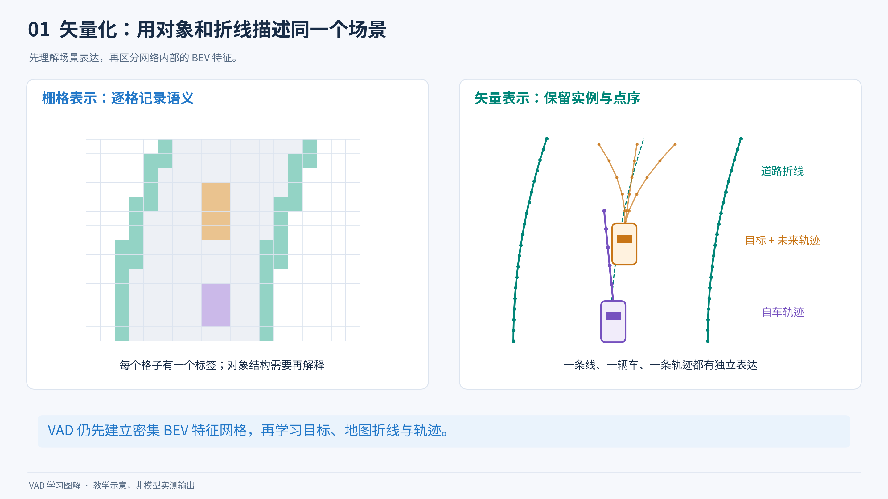

**图解 01｜先理解“用什么描述世界”。** 左侧每个格子记录语义；右侧把道路、目标和未来轨迹作为有结构的对象表示。先找两边的紫色自车和橙色目标，再观察道路曲线怎样被一串有顺序的点描述。左侧只是栅格语义表示的示意，不是 VAD 内部 BEV 特征的直接可视化。

### 1.4 本工作区的版本边界

| 范围 | 实际提供内容 | 阅读优先级 |
| --- | --- | --- |
| VAD v1 | nuScenes 数据转换、数据集、六份配置、模型、训练和离线评估入口 | 最先学习 |
| `VADv2/` | 一份 CARLA 配置和一个 head，引用了若干本仓库缺失模块 | 理解 v2 思路时再看 |
| `bevformer/` | 保留的 BEVFormer 实现，与 VAD 的 BEV 模块大量相同 | 用来理解来源与对照 |
| 通用 `_base_` 配置和工具 | 检测、分割、数据集、训练日程模板等 | 按需查询 |

README 展示论文的开环和闭环结果，不代表当前工作区包含所有对应实验的完整代码、数据和控制接口。本文也不把 README 的 FPS 和精度当成本机实测。

## 2. 读代码前需要认识的术语

| 术语 | 通俗解释 | 仓库中的例子 |
| --- | --- | --- |
| Ego 自车 | 当前正在作决策的这辆车 | `ego_fut_preds` |
| Agent 交通参与者 | 周围可能运动的对象 | 其他车辆、行人、自行车 |
| GT 真值 | 数据集提供的参考答案 | 真实框、未来轨迹、地图线 |
| Backbone 主干 | 从图像中提取特征的网络 | ResNet-50 |
| Feature 特征 | 网络学到的一组数字描述 | 256 维向量，不是人工规定的 256 个语义 |
| Neck | 整理主干的输出尺度与通道 | FPN |
| Head | 从特征产生具体预测的模块 | `VADHead` |
| BEV 鸟瞰图表达 | 像从上往下看一样组织车周围信息 | BEV 特征网格 |
| Query | 一个可学习的信息槽或提问向量 | 目标 query、地图 query、自车 query |
| Token | Transformer 处理的一条特征 | 一个 BEV 格子对应的向量 |
| Attention 注意力 | 根据相关程度从其他特征中取信息 | 自车 query 关注其他车辆 |
| Self-attention | 同一组特征内部互相交流 | 运动候选之间交互 |
| Cross-attention | 一组特征从另一组特征获取信息 | BEV query 从相机特征取信息 |
| Deformable attention | 选少量可学习位置进行采样 | 不必让每个 BEV 格子遍历每个图像像素 |
| Position encoding | 为特征加入位置信息 | BEV 行列位置编码 |
| Encoder 编码器 | 构建公共特征表达 | BEV encoder |
| Decoder 解码器 | 根据 query 从特征中读出结果 | 检测、地图 decoder |
| MLP | 由全连接层等组成的小网络 | 将 query 映射为类别分数和坐标 |
| Regression 回归 | 预测连续数值 | 坐标、尺寸、未来位移 |
| Classification 分类 | 预测类别或候选适合程度 | 车/行人、运动模式分数 |
| Loss 损失 | 预测与目标不一致程度的数值 | 轨迹 L1 损失 |
| Backprop 反向传播 | 根据损失计算参数应该怎样改变 | `loss.backward()` |
| Optimizer 优化器 | 使用梯度更新参数 | AdamW |
| Batch | 一次迭代处理的一组样本 | 默认每 GPU 一个时间队列 |
| Iteration 迭代 | 取 batch、预测、计算损失、更新参数一次 | 不是看完整个训练集 |
| Epoch | 完整遍历一次训练集 | stage-1 配置为 48 epochs |
| Checkpoint | 保存的模型权重及可能包含的训练状态 | `.pth` 文件 |
| Pipeline | 把原始样本加工成输入的一连串步骤 | 读图、归一化、缩放、打包 |
| Registry 注册表 | 从名字找到对应 Python 类的机制 | `type='VAD'` 找到 `VAD` 类 |
| Hungarian matching | 为无序预测和真值做一对一配对 | 300 个预测槽与真值目标匹配 |
| Mask | 标记有效内容与应忽略内容 | 缺失未来时刻不能当作真实零位移 |
| Mode 运动模式 | 对同一个未来提出的一种可能性 | 一个目标的 6 条候选轨迹 |
| Open-loop 开环 | 对已录制数据预测并评分 | 本仓库 nuScenes 主线 |
| Closed-loop 闭环 | 执行预测后环境发生变化，再继续决策 | 需要仿真器或车辆与控制器 |

<a id="vad-figure-04"></a>

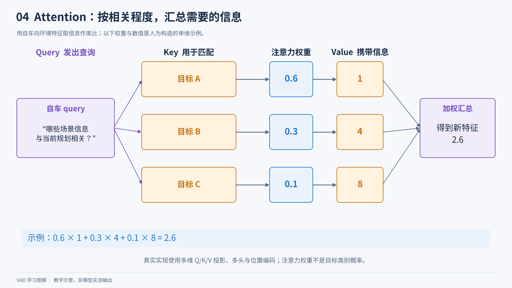

**图解 04｜把 Attention 理解成“带着问题取信息”。** Query 表达当前想知道什么，Key 帮助判断哪条信息相关，Value 是实际取回的内容。示例把三个值按 0.6、0.3、0.1 加权，得到 `0.6×1 + 0.3×4 + 0.1×8 = 2.6`。真实网络操作的是向量和多头注意力；这些权重也不是目标类别概率。这张图解释一般注意力直觉，不能直接当作 BEV 可变形注意力的全部实现。

不要混淆：**300 个目标 query** 是容纳目标的槽位数；**6 种运动模式** 是每个目标的未来候选数；**3 个自车规划分支** 对应右转、左转、直行。这三个数字描述不同维度。

## 3. 目录与算法总图

### 3.1 顶层目录

```text
VAD/
├── README.md                   项目介绍、结果、论文与运行文档链接
├── LICENSE                     Apache 2.0 许可
├── requirements.txt            原环境的 Conda 风格包版本清单
├── assets/                     架构图片
├── docs/                       安装、数据、运行、可视化文档和本文
├── projects/
│   ├── configs/
│   │   ├── VAD/                v1 六份实验配置
│   │   ├── datasets/           自定义数据集基础配置
│   │   └── _base_/             通用模型、数据、日程、运行时模板
│   └── mmdet3d_plugin/
│       ├── VAD/                核心模型、BEV、规划损失、训练适配
│       ├── datasets/           数据集、增强、采样器和地图评估
│       ├── core/               匹配、解码、框结构、评估工具
│       ├── models/             可复用主干、增强、嵌入、优化器等
│       └── bevformer/          保留的 BEVFormer 实现
├── tools/
│   ├── train.py / test.py      命令行运行入口
│   ├── data_converter/         数据预处理
│   ├── analysis_tools/         日志、复杂度、速度和可视化
│   ├── misc/                   浏览数据、打印配置、融合 BN 等
│   └── model_converters/       通用权重转换和裁剪
└── VADv2/                      v2 部分核心代码
```

`.git/` 是版本管理数据；当前环境里的 `.agents/`、`.codex/`、`.aws/` 是工作区辅助目录，不是 VAD 算法源码。`data/`、`ckpts/`、`work_dirs/` 等是运行时准备或生成的目录，初始工作区没有提供数据集和模型权重。

每个子文件夹及全部原始文件的作用见 [逐文件导航](VAD_逐文件导航.md)。不要看到某个文件存在，就认为它一定参与当前配置的训练。

### 3.2 前向计算总图

<a id="vad-figure-02"></a>

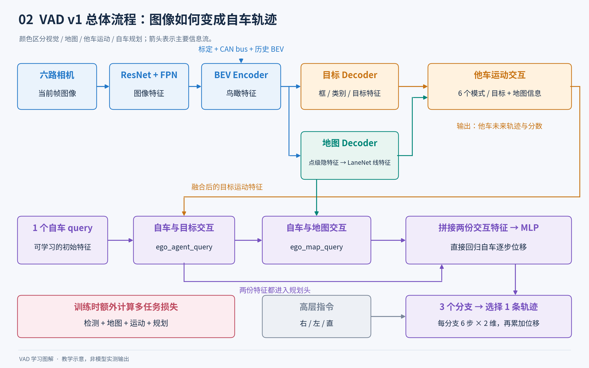

**图解 02｜第一遍只跟着箭头走。** 蓝色构建视觉与 BEV 特征，橙色处理目标运动，绿色处理地图，紫色完成自车规划。下半部分的两条紫色输入提醒我们：规划 MLP 会同时使用自车与目标交互后的特征、自车与地图交互后的特征。高层命令用来选择已预测的三个分支；最终输出还需要累加位移才成为轨迹点。地图 Decoder 另有地图类别和坐标输出，LaneNet 读取的是点级隐特征。

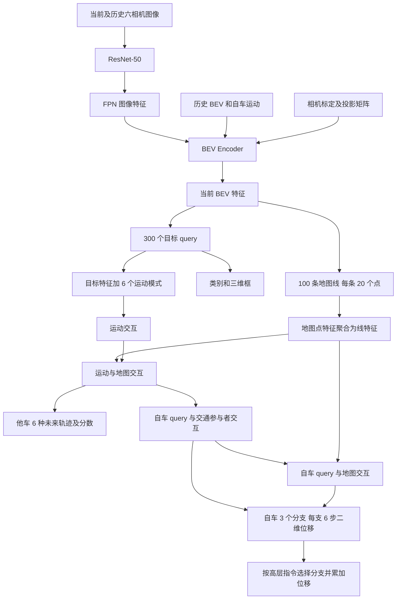

文字版是：图像 → 图像特征 → BEV → 目标与地图 → 他车运动 → 自车规划。历史 BEV 帮助利用过去，相机标定帮助把三维位置对应到图像位置。

`VAD.py` 组织训练、历史帧和推理；`VAD_head.py` 连接检测、地图、运动、规划及损失；`VAD_transformer.py` 组织 BEV 与目标/地图解码器。这三个文件是核心阅读入口。

### 3.3 预测输入和评估附带数据的区别

| 信息 | 作用与默认行为 |
| --- | --- |
| 六路图像 | 主要视觉输入 |
| 相机标定、`lidar2img` | 将三维参考点投影到图像；名称里有 lidar 不代表使用点云网络 |
| `can_bus`、帧间运动 | 默认用于历史 BEV 对齐与状态嵌入 |
| `ego_his_trajs` | 支持可选历史轨迹编码；六份 v1 配置都设 `ego_his_encoder=None` |
| `ego_lcf_feat` | 支持可选低维自车状态；六份 v1 配置都设 `ego_lcf_feat_idx=None`，不等于关闭 CAN bus |
| `ego_fut_cmd` | 为监督和评估选择右/左/直分支；由真实未来轨迹提取，在线需由导航等提供 |
| 真实未来、真实框、地图真值 | 用于训练监督和离线评估 |
| 测试 pipeline 读取的点云 | 保留的数据字段；主前向不做 LiDAR 特征提取 |

所以，`use_map=False` 不表示训练不需要地图真值；`use_lidar=False` 不表示数据处理完全不读 LiDAR 文件；head 不用未来真值预测，也不表示现有测试入口已经适合无标注实时相机流。

### 3.4 配置如何变成 Python 对象

配置是一组 Python 字典。例如 `type='VAD'` 指定总模型，`pts_bbox_head.type='VADHead'` 指定预测头。插件导入时通过 `__init__.py` 执行注册，再由框架的 `build_model()` 等函数找到并构建这些类。

ResNet、FPN、标准 runner 等来自安装的依赖，不必在本仓库找到完整定义。名称 `pts_bbox_head`、`forward_pts_train` 沿用了三维检测框架的习惯；不能仅凭 `pts` 就判断它在处理点云。

六份 VAD 配置只继承 `../datasets/custom_nus-3d.py` 和 `../_base_/default_runtime.py`，再覆盖相关值。基础数据配置中的点云 pipeline、类别顺序和检测范围不一定是最终生效值。阅读实验时以最终合并的配置为准，`_base_/` 下其他模板不会被自动全部加载。

## 4. 读懂六份 VAD v1 配置

### 4.1 Tiny 和 Base

| 参数 | Tiny | Base |
| --- | --- | --- |
| 主干 | ResNet-50 | ResNet-50 |
| 主干输出索引 | `(3,)` | `(1,2,3)` |
| FPN 输出尺度数 | 1 | 4 |
| 特征维度 D | 256 | 256 |
| 图像缩放 | 0.4 | 0.8 |
| 1600×900 原图缩放后宽×高 | 640×360 | 1280×720 |
| 按 32 补齐后的宽×高 | 640×384 | 1280×736 |
| BEV 网格 | 100×100 | 200×200 |
| BEV token 数 | 10,000 | 40,000 |
| BEV encoder 层数 | 3 | 6 |
| 目标 decoder 层数 | 3 | 6 |
| 地图 decoder 层数 | 3 | 6 |
| 训练队列长度，含当前帧 | 3 | 4 |
| 目标 query | 300 | 300 |
| 地图实例数 × 每条点数 | 100×20 | 100×20 |
| 他车模式 / 自车分支 | 6 / 3 | 6 / 3 |
| 未来时间步 | 6 | 6 |
| 默认每 GPU batch | 1 | 1 |

两者范围均为 `[-15,-30,-2,15,30,2]`，平面上 x 跨度 30 米、y 跨度 60 米。因此 Tiny 的 BEV 单元对应 x 约 0.3 米、y 约 0.6 米；Base 为 x 约 0.15 米、y 约 0.3 米。不要把 BEV 分辨率和配置中兼容保留的 `voxel_size` 当成同一个东西。

Tiny 与 Base 的算法主线相同，Tiny 使用更小图像、更少 BEV 格子和更浅层数，适合先理解结构。具体显存和速度仍受设备、算子、依赖和 batch 等影响。

### 4.2 一次联合训练与两阶段训练

| 配置后缀 | 轮数 | 权重来源 | 训练意图 |
| --- | --- | --- | --- |
| `stage_1.py` | 48 | ResNet 图像预训练 | 学习目标、地图和运动；四项规划损失权重均为 0 |
| `stage_2.py` | 12 | 对应 Tiny/Base 的 stage-1 checkpoint | 开启规划损失，继续联合训练其他任务 |
| `e2e.py` | 60 | ResNet 图像预训练 | 从训练开始联合优化全部任务 |

第二阶段没有整体冻结感知与预测：检测分类/框损失权重从 `2.0/0.25` 调为 `0.8/0.1`，地图分类/点损失从 `2.0/1.0` 调为 `0.8/0.4`，运动损失继续保留。主干早期层冻结和 BN 固定则是六份配置共同的设置。

第一阶段也仍会构建、执行规划分支，只是规划损失乘以零。两阶段训练与 DETR 参数 `as_two_stage` 也不是同一概念：六份 v1 配置的 `as_two_stage` 都是 `False`。

### 4.3 优化器和训练日程

v1 默认使用 AdamW，基础学习率 `2e-4`，权重衰减 `0.01`。图像主干学习率乘 `0.1`，即对应参数组的基础学习率为 `2e-5`。梯度范数最大值为 35，用于缓和梯度过大造成的不稳定。

前 500 次迭代使用线性 warmup，初始比例 `1/3`；整体采用余弦衰减，最小比例 `1e-3`。`warmup_iters` 的单位是迭代，不是 epoch。`use_traj_lr_warmup=False` 则是另一项可选轨迹损失调节开关，与优化器 warmup 不同。

默认每个 epoch 保存一次权重，日志每 100 次迭代输出，验证间隔等于该阶段总轮数。具体 loss 权重、匹配代价、默认损失是否实际使用，后面的模型实现章节会继续展开。

## 5. 数据准备 样本组织与评估

### 5.1 训练样本不是一张照片

一次训练样本是“当前时刻 + 几个历史时刻”。每个时刻包含 6 个摄像头的图像；当前时刻另有车辆/行人框、其他交通参与者的未来运动、局部地图、自车未来轨迹等答案。网络根据图像产生预测，训练程序再把预测与答案比较。

必须分清三类信息：

- **模型输入**：主要是历史与当前图像，以及相机标定、车辆位姿/CAN bus 等辅助信息。高层驾驶命令用于规划分支。一个字段被搬进 batch，不代表它一定被网络用于提取特征。
- **监督标签 GT**：告诉模型正确答案，例如“当前车辆在这里，3 秒后走到那里”。GT 是 Ground Truth 的缩写。
- **评估和可视化材料**：测试 pipeline 也读取点云、真实未来轨迹和地图，便于算分和画图；这不等于视觉编码器以 LiDAR 或真实未来轨迹作为感知输入。

当前测试程序服务于有标签验证集上的离线评估。它不是拿来就能接摄像头视频上线的无标注部署接口。

### 5.2 原始数据如何转成 VAD 的资料索引

真正入口是 [vad_nuscenes_converter.py](../tools/data_converter/vad_nuscenes_converter.py)，主要函数为 `create_nuscenes_infos`（第 46 行）、`_fill_trainval_infos`（第 195 行）、`nuscenes_data_prep`（第 917 行）。脚本读取 nuScenes 原始记录、图像/点云路径和 CAN bus，并输出：

```text
{prefix}_infos_temporal_train.pkl
{prefix}_infos_temporal_val.pkl
{prefix}_infos_temporal_test.pkl
```

`.pkl` 可以看作“提前整理好的一帧帧资料索引”，主要保存路径、标定、位姿和标签，不把所有图像像素打包进去。最外层结构是：

```python
{
    'infos': [第0帧字典, 第1帧字典, ...],
    'metadata': {'version': 'v1.0-trainval'}
}
```

`--extra-tag` 决定 prefix，`--out-dir` 决定输出目录。`--max-sweeps 10` 指保存多少历史 LiDAR sweep 信息，不是模型的图像时序队列长。

版本 `v1.0-mini` 使用 mini 的 train/val 场景，**文件名仍然是 temporal_train/val.pkl**，没有自动加 mini 后缀。若 mini 与完整版使用同一输出目录和前缀，会写到相同文件名；学习时应分开数据根目录、输出目录或前缀，并让配置读取对应文件。原始 metadata 会记录 `v1.0-mini`。

普通 `--version v1.0` 分支先处理 trainval，再继续处理官方 test；若仅下载 trainval，可能已经写出 train/val pkl 后在处理 test 时失败。不能把“后半段报错”与“前半段没生成”混为一谈。

[tools/create_data.py](../tools/create_data.py) 是遗留的通用多数据集入口。它导入当前目录中不存在的 `nuscenes_converter`、`lyft_converter`、`kitti_converter`、`indoor_converter`，不是这个仓库已完整提供的 VAD 数据准备主线。

### 5.3 一帧 pkl 包含什么

以下采用转换器默认 `fut_ts=6`、`his_ts=2`。N 是一帧物体数量。

| 字段 | 内容/形状 | 用途 |
|---|---|---|
| `token,prev,next,scene_token,frame_idx` | 当前样本、相邻样本、场景 ID 和场景帧序号 | 找到同一段连续驾驶，防止混入其他 scene |
| `timestamp` | 原始微秒时间戳 | 对齐数据，dataset 再转为秒 |
| `lidar_path,sweeps` | 当前点云路径、历史 sweep 信息 | 坐标参考、辅助加载与可视化 |
| `cams` | 6 相机路径、内参、外参、时间戳 | 读图和进行三维到二维投影 |
| `lidar2ego_*` | LiDAR 到车体的旋转和平移 | 坐标转换 |
| `ego2global_*` | 车体到世界的旋转和平移 | 地图裁剪、跨帧对齐 |
| `can_bus` | 18 维数组 | 位姿及车辆运动信息；dataset 会重写其中部分位姿字段 |
| `map_location` | 城市地图名称 | 选择四个 nuScenes 地图之一 |
| `fut_valid_flag` | 是否具备完整 6 步未来 | 规划评估只汇总完整未来样本 |
| `gt_boxes` | `[N,7]`，位置 3 + 尺寸 3 + yaw | 当前 3D 检测 GT |
| `gt_names` | `[N]` 类别名 | 映射为类别编号 |
| `gt_velocity` | `[N,2]` | 当前 LiDAR 坐标中的物体速度 |
| `num_lidar_pts,num_radar_pts,valid_flag` | 各 `[N]` | 框是否有传感器点支持；valid 为两类点数之和大于 0 |
| `gt_agent_fut_trajs` | `[N,12]`，原为 `[N,6,2]` | 物体未来每一步二维位移 |
| `gt_agent_fut_masks` | `[N,6]` | 每个未来时刻是否有 GT |
| `gt_agent_lcf_feat` | `[N,9]` | `(x,y,yaw,vx,vy,width,length,height,type)` |
| `gt_agent_fut_yaw` | `[N,6]` | 相邻未来时刻 yaw 差 |
| `gt_agent_fut_goal` | `[N]` | 从未来运动提取的方向类别，静态设为 9 |
| `gt_ego_his_trajs` | `[2,2]` | 自车历史两步位移 |
| `gt_ego_fut_trajs` | `[6,2]` | 自车未来六步位移 |
| `gt_ego_fut_masks` | `[6]` | 自车未来有效性 |
| `gt_ego_fut_cmd` | `[3]` | 右转、左转、直行的 one-hot 命令 |
| `gt_ego_lcf_feat` | `[9]` | 代码记录的自车速度分量、加速度、yaw 角速度、长宽、速度、曲率 |

`gt_agent_lcf_feat` 的 type 使用 nuScenes 原始类别表编号，不是主线 10 类的标签编号；`gt_agent_fut_goal` 也不是自车三类命令。

上述 `gt_*` 在转换器 `if not test:` 分支中生成。官方无 GT test pkl 不含 `gt_ego_*`，但当前 dataset 无条件访问这些字段并调用 `get_ann_info`。所以“转换器可生成 temporal_test.pkl”不等于“当前现成 pipeline 可直接无 GT 推理官方 test”。现有 VAD 测试配置读取的是 temporal_val.pkl。

#### offset：保存的是每一步走了多少

物体的 `sample_annotation.next` 把同一对象的未来 GT 串起来。未来框从世界坐标转换到**当前帧固定的 LiDAR 坐标系**，然后做相邻时刻差分。

设同一个固定坐标系中的位置为 `p0,p1,...,p6`，保存的是：

```text
Δp1 = p1 - p0
Δp2 = p2 - p1
...
Δp6 = p6 - p5
```

恢复当前局部坐标中的轨迹，要累计相加：

```python
future_positions = current_center + offsets.cumsum(axis=-2)
```

例如当前中心是 `(3,5)`，三步位移都是 `(0,1)`，未来点为 `(3,6),(3,7),(3,8)`。不能直接把三个 `(0,1)` 当成未来绝对坐标。

所有未来步使用当前时刻那套固定坐标轴，而不是每一步都换到未来自车坐标；否则连续点无法直接相减或画在同一张 BEV 图上。

自车未来也采用逐步 offset。严格说，`get_global_sensor_pose`（转换器第 541 行）计算 `global_from_ego @ ego_from_sensor`，取的是 **LiDAR 传感器原点随车辆运动的位置**。仓库称它 ego trajectory，但不要未经变换就当成任意车辆后轴中心。

代码把时间步按约 0.5 秒处理：速度计算中有 `/0.5`，规划评估每秒取两步。因此 6 步是约 3 秒，2 步历史是约 1 秒。这个 `his_ts=2` 与图像时序队列 `queue_length=3/4` 是两个不同概念。

#### mask：零位移不一定表示停住

如果某物体未来第 3 步以后没有后续标注，剩余 offset 填 0、mask 填 0。这些零表示“后面不知道”，而不是“确定静止”。损失和指标应忽略无效时刻。

自车到 scene 结尾后，未来位置用末位置补齐，差分后也变成 0，mask 同时为 0。`fut_valid_flag=False` 的帧不进入最终规划指标平均。历史不足时，转换器根据已知位移向前外推补齐历史数组，没有相应 history mask。

<a id="vad-figure-07"></a>

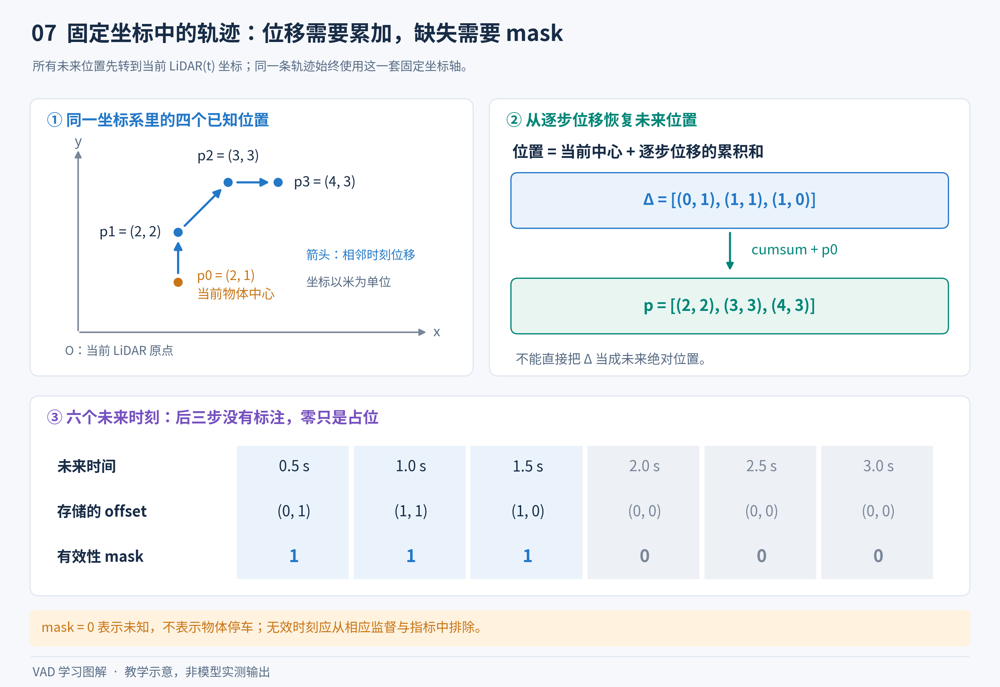

**图解 07｜画轨迹前，先做这道加法题。** 左图中的四个位置始终使用当前帧的同一套坐标轴；右图将逐步位移累加，再加当前目标中心，恢复未来位置。下方灰色时间步表示没有标注，零位移只是占位。对自车而言，本仓库轨迹参考原点是当前 LiDAR 原点；不能未经坐标转换就解释成任意车辆中心或后轴中心。

#### 驾驶命令来自真实未来：这是评估的重要前提

转换器第 451—457 行根据**真实未来最后一点**在当前 LiDAR 坐标中的 x 位置定义：

```text
x >= +2 米 → [1,0,0] → 右转
x <= -2 米 → [0,1,0] → 左转
其余        → [0,0,1] → 直行
```

因此离线评估默认已知一个从未来真实行为提取的高层方向提示。模型解决的是“给定右转/左转/直行意图后应该怎样规划”，不代表它自行选择目的地、生成导航路线。实际部署需要导航或任务层提供等价命令，而不是读取真实未来。

也不要把通用 3D box 类文档中的坐标箭头未经标定核对就套到 nuScenes 传感器坐标上；这里“右/左”的语义应结合实际传感器朝向与转换器这段命令规则理解。

### 5.4 Dataset 如何组装训练数据

[nuscenes_vad_dataset.py](../projects/mmdet3d_plugin/datasets/nuscenes_vad_dataset.py) 是主线数据中枢，包含三个主要类：

- `LiDARInstanceLines`，第 32 行：地图折线实例、包围框、定长采样、不同起点/方向的等价排列。
- `VectorizedLocalMap`，第 475 行：依据当前位姿裁出局部矢量地图。
- `VADCustomNuScenesDataset`，第 980 行：帧读取、标签、pipeline、历史队列、输出格式与评估。

#### `get_data_info`：整理当前帧资料

第 1271 行的 `get_data_info(index)` 从 pkl 取路径、位姿、轨迹，构建每个相机的 `lidar2img`，读取 GT。这个矩阵完成“LiDAR 空间点 → 相机坐标 → 像素坐标”，让 BEV 编码器知道应从哪张图片的哪里提取特征。

它还把 CAN bus 中 `[:3]` 改为当前位置，`[3:7]` 改为姿态四元数，`[-2]` 改为绝对 yaw 弧度，`[-1]` 改为绝对 yaw 角度。训练时序拼接随后再将位置和最后一个角度改成相邻帧差值。

`get_ann_info`（第 1210 行）过滤无效框，把名字映射为检测类别，加上 vx、vy，并把 nuScenes 重心框转换到 OpenMMLab box 容器。默认 `with_attr=True` 时，将 agent 标签打包为 `[N,34]` 的 `attr_labels`：

| 切片 | 内容 |
|---|---|
| `0:12` | 六步二维未来 offset |
| `12:18` | 六步 mask |
| `18:19` | future goal |
| `19:28` | 九维当前 agent 特征 |
| `28:34` | 六步 future yaw 差 |

这里借用属性标签的名字传递运动标签，并不是简单的“运动中/停着”属性。

训练配置显式 `use_valid_flag=True`，只要 LiDAR/Radar 总点数大于 0 即保留。val/test 未显式设该参数时，应核对所安装 MMDetection3D 父类默认值，不能武断地认定全部 split 采用完全相同的框过滤。

#### Pipeline：一帧字典的流水线

以 base 配置为例：

```text
读取6相机图像并转float32
→ 随机亮度、对比度、饱和度、色调扰动
→ 加载3D框、类别、属性/轨迹
→ 按空间范围过滤对象，连同轨迹同步过滤
→ 按目标类别过滤对象，连同轨迹同步过滤
→ 图像减均值/除标准差
→ 按0.8缩放图片，同步更新lidar2img
→ pad到32倍数
→ Tensor/DataContainer格式化
→ Collect选择需要字段
→ dataset额外加入局部矢量地图GT
```

Tiny 图像缩放比例为 0.4。`RandomScaleImageMultiViewImage` 虽叫 RandomScale，构造函数断言 `len(scales)==1`，当前实际为固定比例缩放。

图像缩小时要同步缩放 `lidar2img`，否则同一个 BEV 点会去错误像素取特征。补边只改变图像张量尺寸，不意味着真实世界范围增大。对象范围过滤主要检查 BEV x/y 范围，不是把每个 3D 框按完整体积裁开。

自定义 object filter 必须同时筛选框、类别和 future attributes；如果只删框不删轨迹，后面的第 i 个框就会配到第 j 个对象的未来运动。

测试没有光照扰动，额外读取点云，通过 `MultiScaleFlipAug3D` 包装单尺度、无翻转处理；因此带额外 list 包装不代表实际进行了多尺度融合。

#### 历史队列：有时间采样增强

`prepare_train_data`（第 1117 行）设当前 index 为 t，队列长为 Q，则先列出 `t-Q,...,t-1` 共 Q 个历史候选，随机删去一个，再加当前帧，使总帧数为 Q。

例如 base 的 Q=4，会从 `t-4,t-3,t-2,t-1` 随机删去一帧，保留三帧历史加当前 t；所以不是始终连续的 `t-3,t-2,t-1,t`。Tiny 的 Q=3。

历史帧必须 `frame_idx` 更小且 `scene_token` 相同，否则复制最近可用样本补齐，避免跨场景混合。最终队列从旧到新排列。

`union2one`（第 1179 行）堆图像为 `[Q,6,3,H,W]`，并保留每个时刻的 meta。首时刻 `prev_bev=False`，位置/角度增量清零；之后 `prev_bev=True`，位置和角度改为相对前一队列帧的差。网络就能知道旧 BEV 应如何移动/旋转以对齐当前帧。

返回值基于 `queue[-1]`：**保留全部历史图像/meta，但 GT 框、地图、轨迹等只保留当前帧标签。** 前面虽然也给历史帧执行了地图生成，历史标签最终没有整队列送给 loss。

当前样本没有满足条件的 GT 时，`__getitem__`（第 1395 行）重新抽样。因此原始索引被遍历一次，不等于每一帧都恰好作为有效当前帧训练一次。

#### Batch 形状

以下是去掉 DataContainer 后的典型训练结构，B 为每 GPU batch，Q 为队列长，N/M 为物体数/地图实例数：

| 字段 | 形状/容器 | 含义 |
|---|---|---|
| `img` | `[B,Q,6,3,H,W]` | 多时刻六相机图像 |
| `img_metas` | B 个按时序编号索引的字典 | 各帧投影、尺寸、scene、CAN bus |
| `gt_bboxes_3d` | B 个 box 容器，通常每个 `[N,9]` | 物体数可不同 |
| `gt_labels_3d` | B 个 `[N]` Tensor | 检测类别 |
| `gt_attr_labels` | B 个 `[N,34]` Tensor | agent 未来/当前特征 |
| `map_gt_bboxes_3d` | B 个 `LiDARInstanceLines` | 名字叫 bboxes，实为地图线对象 |
| `map_gt_labels_3d` | B 个 `[M]` Tensor | 地图类别 |
| `ego_his_trajs` | `[B,1,2,2]` | 历史 offset |
| `ego_fut_trajs` | `[B,1,6,2]` | 未来 offset |
| `ego_fut_masks` | `[B,1,1,6]` | 未来 mask |
| `ego_fut_cmd` | `[B,1,1,3]` | 方向命令 |
| `ego_lcf_feat` | `[B,1,1,9]` | 自车状态 |

[formating.py](../projects/mmdet3d_plugin/datasets/pipelines/formating.py) 负责自车字段增加这些 singleton 维度。DataContainer 是旧版 MMCV 的“打包说明”：`stack=True` 可堆成规则 Tensor，`cpu_only=True` 保留为 CPU 对象；它不是网络层。变长物体标签用列表保留。

`prepare_test_data`（第 1163 行）仅返回当前帧，没有显式 Q 帧训练队列；测试的历史由模型维护 previous BEV 缓存。

### 5.5 地图 GT 与一条线的多种等价写法

地图 GT 不是 converter 提前塞入每个 pkl 的 20 个点。pkl 保存城市和位姿；`VectorizedLocalMap` 加载四个城市地图，再按当前 LiDAR 原点与朝向裁剪局部区域。`lidar2global = ego2global @ lidar2ego` 把局部 patch 放到世界地图上，抽取的图层随后变换回局部。

主线局部平面范围 x 为 -15..15 米，y 为 -30..30 米，宽 30 米、高 60 米。三类地图如下：

| 网络类别 | nuScenes 图层 | 处理 |
|---|---|---|
| divider，0 | road_divider + lane_divider | 提取分隔线实例 |
| ped_crossing，1 | ped_crossing 多边形 | 合并多边形，提取外边界/内环并局部裁剪 |
| boundary，2 | road_segment + lane 多边形 | 求并集，提取道路区域外边界/内环 |

`fixed_num_sampled_points`（第 102 行）沿弧长等距采样。配置每条线 20 点，得到 `[M,20,2]`，相当于用 20 个按顺序连接的点近似一条复杂曲线。

同一条开放线 A→B 与 B→A 是同一几何对象；闭合边界还能从不同顶点开始。如果强制唯一写法，预测了正确形状却换了起点，模型仍会受罚。所以代码为每条 GT 生成多个等价点序。

主线 `map_gt_shift_pts_pattern='v2'` 对应第 253 行：开放线生成正序/反序；闭合线轮换原始顶点起点后重新等距采样。20 点对应最多 19 种候选点序，多的随机抽取，少的用 -10000 补齐。其他 v1/v3/v4/torch 是备选变体，不应笼统声称当前 v2 对闭合线一定枚举所有正反方向。

地图 Hungarian 匹配先为每对“预测线、GT 线”选择代价最低的等价点序，再一对一分配实例。`map_gt_bboxes_3d` 实际保存线对象，模型可取它的 `.bbox`，但地图主要内容仍是点序列。

<a id="vad-figure-09"></a>

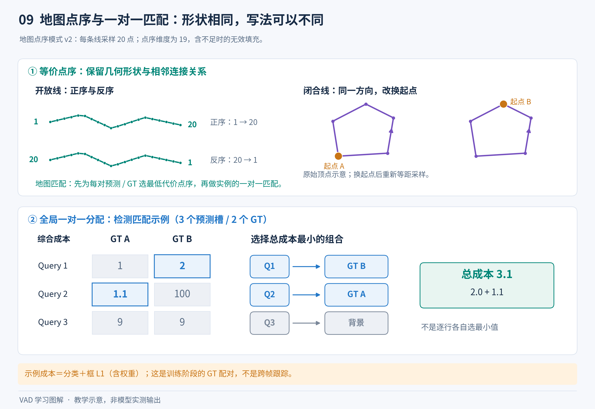

**图解 09｜几何对象相同，不代表数组写法相同。** 上半部分解释为什么开放线需要允许反向读点，闭合线需要允许改变起点；当前点序模式 v2 的细节以上文为准。下半部分用一个检测成本矩阵说明全局配对：`Q1→B、Q2→A` 的总成本是 3.1，剩下的 Q3 学习背景。这是训练预测与 GT 的匹配，不是跨帧跟踪，也不是每行独立找最小值。匹配器与成本实现见 5.7 节。

### 5.6 数据加载器怎样保证训练与测试顺序

[builder.py](../projects/mmdet3d_plugin/datasets/builder.py) 的 `build_dataloader`（第 24 行）调用 PyTorch DataLoader，配合 MMCV collate 处理 DataContainer。

训练的 [DistributedGroupSampler](../projects/mmdet3d_plugin/datasets/samplers/group_sampler.py) 按 `dataset.flag` 分组、组内随机打乱、补齐整卡批大小，再分配给各 GPU；随机种子结合 `epoch + seed`。当前帧可以打乱，因为每个 dataset item 自己回查历史，不要求相邻 batch 是同一 scene。

测试的 [DistributedSampler](../projects/mmdet3d_plugin/datasets/samplers/distributed_sampler.py) 关闭 shuffle，并给每张卡分配连续的一段索引，而不是隔 world_size 取一个。这样同一 GPU 的调用尽可能按时间连续，适配 previous BEV 缓存。

为了整除卡数，索引末尾会重复一部分样本。结果收集必须按连续分片拼接并裁去多余样本，不能用交错拼接。sampler 与 VAD 自定义多卡收集应成对理解。

连续分片仍可能在 scene 中间切开；每个分片起点没有前面那段历史缓存，各 GPU 也不会共享 BEV。连续分片不是完整的跨卡时序状态同步。这是源码的采样设计，不表示当前多卡评估已经可靠；还存在后文说明的结果包装接口问题，复现应使用单 GPU 非分布式评估。

`worker_init_fn` 给 worker 设置 NumPy/Python random 种子。builder 还支持 concat、repeat、class-balanced、CBGS 包装，这些是可选通用能力，不代表主线一定启用。

### 5.7 Core 的作用：配对、编码、解码

#### 检测的一对一匹配

[hungarian_assigner_3d.py](../projects/mmdet3d_plugin/core/bbox/assigners/hungarian_assigner_3d.py) 第 52 行 `assign` 把很多预测 query 与较少 GT 做一对一分配。可把它理解为：给每个真实物体挑选一个最合适的候选答卷，同时让所有配对总体误差尽量小。

它计算分类代价 + 编码框前 8 维 L1 代价，用 SciPy `linear_sum_assignment` 求解；未匹配 query 是背景。虽然类里保存 iou_cost，当前实现总成本没有加入 IoU，也没有把速度或未来轨迹纳入匹配成本。

[match_cost.py](../projects/mmdet3d_plugin/core/bbox/match_costs/match_cost.py) 的 `BBox3DL1Cost` 本体是 `torch.cdist(...,p=1) × weight`。

#### 框编码不是简单除以范围

[util.py](../projects/mmdet3d_plugin/core/bbox/util.py) 把：

```text
[cx,cy,cz,w,l,h,yaw,vx,vy]
→ [cx,cy,log(w),log(l),cz,log(h),sin(yaw),cos(yaw),vx,vy]
```

尺寸取 log，角度用 sin/cos 避开 -π/+π 的数值不连续。函数名 `normalize_bbox` 并不意味着把中心除以 pc_range 缩到 0..1；这里 pc_range 参数没有参与计算，其他位置的空间范围映射应另行跟踪。

#### 地图匹配

[map_hungarian_assigner_3d.py](../projects/mmdet3d_plugin/core/bbox/assigners/map_hungarian_assigner_3d.py) 第 57 行组合分类、框、IoU、点序列代价，并对等价点序取最小值。当前地图框和 IoU 成本权重为 0，实际主导项是分类和有序点 L1。额外返回 `order_index`，指明 GT 用哪个起点/方向。

#### NMS-free 后处理

传统检测常用 NMS 删除重复框。主线 [fut_nms_free_coder.py](../projects/mmdet3d_plugin/core/bbox/coders/fut_nms_free_coder.py) 定义 `CustomNMSFreeCoder`：取最后一层分类 sigmoid 分数，展平后选 top-k，找回对应 query 的框/轨迹，解码并按中心范围过滤；主线最多保留 100 个检测候选。

[map_nms_free_coder.py](../projects/mmdet3d_plugin/core/bbox/coders/map_nms_free_coder.py) 同理，最多保留 50 个地图候选，并恢复点的米制坐标。

类别分数是展平取 top-k，因此同一 query 理论上可能通过不同类别条目重复入选；NMS-free 不意味着数学上保证没有重复。基础 [nms_free_coder.py](../projects/mmdet3d_plugin/core/bbox/coders/nms_free_coder.py) 不携带轨迹，当前 VAD 配置用的是扩展版本。

### 5.8 评估指标要连同口径一起看

#### 检测：框找得对不对

`dataset._format_bbox`（第 1449 行）把框从 LiDAR→ego→global，默认跳过分数低于 0.2 的框，根据类别和速度补属性，写出 `results_nusc.pkl` 或 JSON，包含 detection/map/plan 三组结果。

`_evaluate_single`（第 1617 行）调用 [vad_custom_nuscenes_eval.py](../projects/mmdet3d_plugin/datasets/vad_custom_nuscenes_eval.py)，不是旁边的旧版 `nuscenes_eval.py`。它沿用 devkit 的中心距离 AP/NDS 算法，以 0.5/1/2/4 米匹配阈值计算 AP，以 2 米匹配计算平移、尺度、朝向、速度、属性误差。

当前 [vad_nusc_detection_cvpr_2019.json](../projects/mmdet3d_plugin/datasets/vad_nusc_detection_cvpr_2019.json) 的全部类别采用 x/y 为 30/15 米的矩形窗口；标准 detection_cvpr_2019.json 按类别使用不同半径。所以当前 NDS/mAP 与官方完整范围榜单不能无条件直接比较，还要注意输出前 score>=0.2 的截断。

一个需要精确复现时核对的细节：输出端先在真正 ego 坐标过滤矩形范围；评估端依据 devkit `add_center_dist` 生成的 `ego_translation` 分量过滤。该外部函数没有内联在仓库中，应查实际安装 devkit 的坐标定义，不要只凭字段名认定已旋转到车体坐标。

关于 mini：dataset 第 1643—1651 行明确把 `v1.0-mini` 映射为 `mini_val`，把 `v1.0-trainval` 映射为 `val`；评估器的 `load_gt` 也支持 mini。独立评估 CLI 的默认参数才是 val/trainval。dataset 没有本地覆写父类的 annotation/version 加载逻辑，因此仍需确认 metadata 被所安装父类正确读取，修改数据路径、缓存名、split 后再做完整评估。原配置路径默认面向完整版，不能只生成 mini pkl 就宣称无需修改即可完整复现。

#### 地图：道路几何画得对不对

默认 Chamfer 距离可解释为“两组点互相找最近邻，再平均”：

```text
CD(P,G) = 0.5 × [ mean_p min_g ||p-g|| + mean_g min_p ||g-p|| ]
```

单位是米，它关注几何形状而非起始编号。以 0.5、1.0、1.5 米为匹配阈值算每类 AP，再平均；阈值约束平均距离，不表示整条线每个点都在该距离内。

调用链：

```text
mean_ap.format_res_gt_by_classes
→ mean_ap.eval_map
→ tpfp.custom_tpfp_gen
→ tpfp_chamfer.custom_polyline_score
→ mean_ap.average_precision
```

文件分别位于 [mean_ap.py](../projects/mmdet3d_plugin/datasets/map_utils/mean_ap.py)、[tpfp.py](../projects/mmdet3d_plugin/datasets/map_utils/tpfp.py)、[tpfp_chamfer.py](../projects/mmdet3d_plugin/datasets/map_utils/tpfp_chamfer.py)。GT 评估重采样为 100 点，主线 `map_eval_use_same_gt_sample_num_flag=True` 时预测也重采样为 100 点；它与训练的 20 点输出是两个阶段。

可选 IoU 模式先给折线 buffer 成窄多边形，再算 IoU，使用 0.5..0.95 阈值；不是车辆 3D 框 IoU。

地图 GT JSON 已存在时不自动更新，修改范围/类别/验证子集后要检查缓存。格式化函数按结果字典插入次序和 annotation list 直接 zip，而不是每次用 token 重排，也依赖数据顺序一致。

#### 运动：周围交通参与者未来走向是否合理

运动评估先在预测副本中保留 `scores_3d > 0.6` 的目标，再执行匹配。这个阈值不同于检测格式化的 `score >= 0.2`，也不修改返回的原始预测。逐帧指标在 [VAD.py](../projects/mmdet3d_plugin/VAD/VAD.py) 第 468、509 行生成，dataset 负责累计。预测框和 GT 先用中心距离 Hungarian 匹配，超过 2 米不配对；匹配过滤非动态类别，但没有显式要求预测类别与 GT 类别完全相同。

最终报告 car（实际合并 car/truck/bus/trailer）和 pedestrian 两组。construction_vehicle、barrier、traffic_cone、motorcycle、bicycle 被忽略，不能说对全部 10 类都报告运动指标。

- **ADE**：有效未来时刻距离误差的平均，多个候选模式中取最小 ADE。
- **FDE**：最终时刻距离误差，多个模式中取最小 FDE，只在完整六步 GT 上统计。
- **MR**：完整未来、已匹配对象中，最优 FDE 大于 2 米的比例。
- **EPA**：`(hit - 0.5×false_positive) / 完整未来GT数`，hit 是完整未来且最优 FDE<=2 米的匹配。

ADE 最优与 FDE 最优可以来自不同模式，这是“候选中存在好答案”的乐观度量，不代表模型必然选中了那条好轨迹。offset 累计后加上各自 predicted center/GT center，再计算距离，所以指标也包含当前定位误差。

[metric_motion.py](../projects/mmdet3d_plugin/core/evaluation/metric_motion.py) 提供通用 ADE/FDE helper，其中 `get_best_preds` 注释说 min ADE，实际按终点误差选候选；主线 VAD.py 又直接实现了自己的指标计算，不能把 helper 注释当作主线行为。

#### 自车规划：给定命令后预测怎样行驶

VAD.py 第 593 行计算 1、2、3 秒的规划指标，底层 `PlanningMetric` 根据未来 GT 框和轨迹构造占据图，比较命令选出的自车预测轨迹与 GT。

1 秒用前 2 步，2 秒用前 4 步，3 秒用前 6 步；L2 与碰撞指标是对应时段前缀的聚合，不是只检查恰好 1/2/3 秒的一个点。`plan_obj_col` 检查参考点，`plan_obj_box_col` 考虑自车矩形；尺寸、轴变换和 GT 自车本身碰撞时刻的屏蔽应结合 PlanningMetric 源码解释。

dataset 只在 `fut_valid_flag=True` 的帧上平均规划指标。这是开环离线评估：模型预测不会改变下一帧观测，不能由此直接推断闭环驾驶成功率、舒适性、交通规则遵守率或真车安全。

重要的日志实现细节：dataset `evaluate` 打印 motion 和 planning 指标，但最终返回的 `results_dict` 只有 detection/map 评估字典。如果只读 runner 返回值或自动保存的标量表，可能找不到控制台打印的 EPA/ADE/规划指标。

<a id="vad-figure-13"></a>

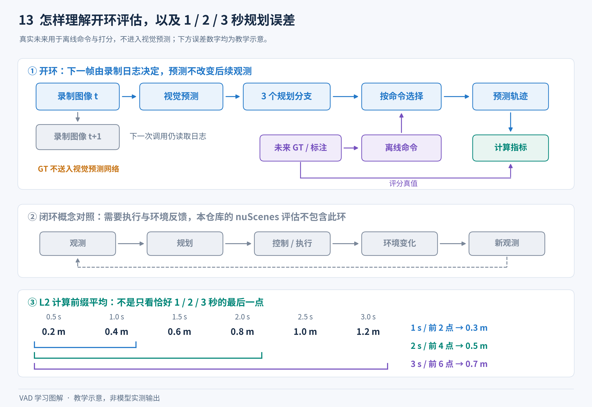

**图解 13｜先看“下一帧从哪里来”，再看指标数字。** 开环的下一帧来自录制日志，执行预测后再得到新观测才形成闭环。图中 GT 一路用于产生离线命令，一路用于评分，都不作为未来图像送进视觉预测网络。下方数字可以手算：前两步误差 `(0.2+0.4)/2=0.3 m`，前四步平均 0.5 m，前六步平均 0.7 m。这说明当前规划 L2 的 1/2/3 秒口径是前缀平均；运动 FDE 等其他指标不能直接套用这一解释。

### 5.9 静态阅读发现的注意点

以下是可定位的实现边界，不是本次运行训练得到的失败结论。

1. `tools/create_data.py` 的若干导入目标缺失；应使用专用 VAD converter。
2. 官方无 GT test 缺少当前 dataset 无条件访问的字段；现有评估主线用 val。mini 与 full 同前缀同输出目录会同名覆盖。
3. 命令由真实未来终点提取，离线成绩以已知高层方向为条件。
4. `transform_3d.py` 第 46 行使用旧式 `np.bool`，与新版 NumPy 的兼容性需检查。地图代码依赖旧 Shapely 的可变 `.coords` 和 STRtree 返回对象语义，依赖升级不能想当然。
5. 转换器 `quart_to_rpy` 按 `(x,y,z,w)` 解包；box future yaw 分支明确按该顺序组装，自车状态分支第 464 行却直接传 pose rotation。四元数顺序值得核对；主线 `ego_lcf_feat_idx=None`，不能仅凭这一点断言默认规划输出受影响。
6. `_get_can_bus_info` 选出 `last_pose` 后，遍历其他字段时却取 `pose[key]`。若循环停在晚于样本的消息，二者可能不是同一个消息，需要核对 CAN bus 时间对齐。
7. `gt_agent_fut_goal` 静态判断为 `coord_diff.max()<1.0`，没有绝对值，和“位移长度小于 1 米”不等价。字段是否被默认 head 使用要继续追踪，生成了不等于参与了 loss。
8. 非主线自定义多 sweep loader 再做 `results['timestamp']/1e6`，而 VAD dataset 已把 timestamp 转成秒。将备用 loader 接回主线前要检查重复换算。
9. motion 汇总除数缺少统一防零处理；没有任何完整未来样本时 planning metric_dict 仍为 None。因此极小片段的冒烟测试不一定能直接执行完整评估。
10. `CustomNuscenesBox.rotate/translate` 修改框中心、方向、速度，没有变换 fut_trajs；输出文件里框到了 global，未来 offset 并没有同时转 global，消费结果时要区分。
11. `get_available_scenes` 实际检查到场景首帧 LiDAR 存在就 break，不是扫描整段所有相机/点云文件。
12. GT 地图缓存只按“文件存在”判断是否重建；切换 mini/full、范围或样本子集时应使用对应缓存。

最有效的阅读顺序是：配置选用了哪个类 → 类接收哪些字段 → 这些字段从哪里生成 → loss/metric 真正读取了哪些切片。目录中的备用类和注释方案不等于当前模型实际执行的算法。

## 6. 模型前向计算 损失与梯度

### 6.1 模型主链：从六张相机照片，到未来三秒的自车轨迹

这一节对应仓库实际运行的 VAD v1。主线配置为 `projects/configs/VAD/VAD_tiny_e2e.py` 与 `VAD_base_e2e.py`，并对照两阶段配置。这里的“端到端”是：从相机图像学习出可供规划使用的特征，最终输出未来轨迹，各任务可以联合训练。它不是“没有中间任务”，也不是“直接产生方向盘和油门控制量”。代码中明确保留目标检测、地图构建、周围车辆轨迹预测和自车规划这几个任务。

最容易记住的一句话是：**先把周围环境看清楚，再用少量物体和线条表示环境，预测别人会怎么走，最后决定自己怎么走。**

#### 一张流程图

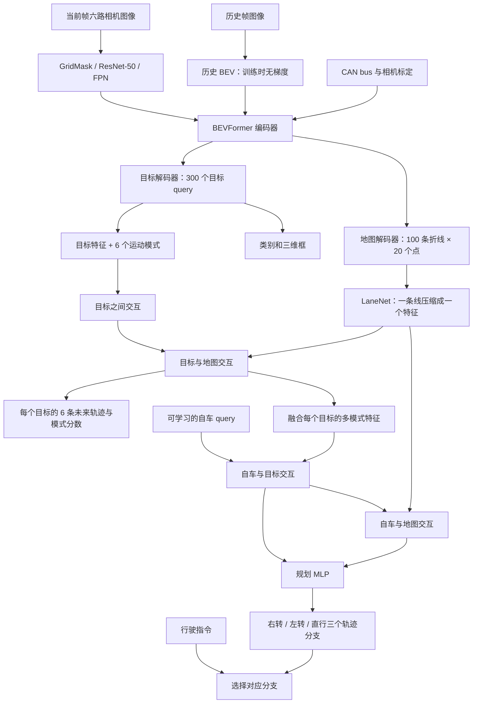

注意图中的行驶指令进入“选分支”，默认模型并不是先把指令编码后才生成轨迹。`VADHead.forward()` 一次输出三个分支；训练时只监督当前指令分支，测试时选择当前指令分支。

源代码入口：[VAD.py](../projects/mmdet3d_plugin/VAD/VAD.py)，`forward()` 第 152 行；[VAD_head.py](../projects/mmdet3d_plugin/VAD/VAD_head.py)，`forward()` 第 481 行。

#### 第一步：图像网络分别处理六个摄像头

[extract_img_feat](../projects/mmdet3d_plugin/VAD/VAD.py) 位于第 65 行。输入通常是 `[B, 6, 3, H, W]`，其中 `B` 是一个 GPU 本次处理的样本数。网络把摄像头维度合并到批次维度，得到 `[B×6, 3, H, W]`，同一套 ResNet 参数分别处理所有相机。

处理顺序是：

1. 按配置选择是否做 `GridMask`，在训练图像上遮挡若干网格块，促使模型不要只依赖局部纹理。
2. ResNet-50 提取图像语义特征。
3. FPN 把选定层级的通道统一为 256。
4. 把相机维度恢复，形成一个特征列表，每项为 `[B, 6, 256, h_l, w_l]`。

Tiny 只使用最后一级 ResNet 输出，FPN 只有一个尺度；Base 使用三个 ResNet 层级，加上 FPN 额外生成的一级，一共四个尺度。

以 nuScenes 通常的 `900×1600` 图像为例，按配置缩放并补齐到 32 的倍数，Tiny 的输入高宽是 `384×640`，Base 是 `736×1280`。按照标准 ResNet/FPN 步幅推算，Tiny 的特征为 `12×20`；Base 的四层为 `92×160、46×80、23×40、12×20`。这是对当前配置和标准输入尺寸的静态推算，输入尺寸变动时应以实际张量为准。

#### 第二步：建立能够记住过去的 BEV

核心代码在 [VAD_transformer.py](../projects/mmdet3d_plugin/VAD/VAD_transformer.py) 的 `VADPerceptionTransformer.get_bev_features()`，第 212 行；以及 [modules/encoder.py](../projects/mmdet3d_plugin/VAD/modules/encoder.py) 的 `BEVFormerEncoder.forward()`，第 142 行。

可以想象自车周围铺着一张空白方格纸，每个格子放一个可学习 query。该格子依次询问：“上一次我这里是什么？”、“现在摄像头里对应的位置有什么？”

当前感知空间是 `x ∈ [-15, 15] 米，y ∈ [-30, 30] 米，z ∈ [-2, 2] 米`。Tiny 把地面划成 `100×100`，Base 是 `200×200`。因此 Tiny 单格对应约 `0.3×0.6 米`，Base 约 `0.15×0.3 米`。虽然网格行列数相同，物理格子不是正方形，因为感知区域宽高不同。

每个 BEV 编码层按以下顺序工作：

1. **时间注意力**：从上一帧 BEV 和记忆中的当前 query 读取信息。上一帧先根据自车角度变化旋转，参考采样位置再按平移量调整。车辆运动使图像发生变化，几何对齐帮助模型比较相同地点的内容。
2. **空间注意力**：每个地面格子沿高度方向取 4 个三维参考点，通过 `lidar2img` 投影到六个摄像头。只对投影可见的摄像头采样特征，再融合多个摄像头的结果。
3. **前馈网络和归一化**：继续加工每个格子的特征。

可变形注意力不是对所有图像像素做完整两两比较，而是围绕投影参考点学习少量采样位置和权重。参考点负责给出“应该去哪里找”，学习到的偏移量允许网络在附近寻找更有用的内容。

[encoder.py](../projects/mmdet3d_plugin/VAD/modules/encoder.py) 第 44 行生成参考点，第 86 行 `point_sampling()` 做投影；[spatial_cross_attention.py](../projects/mmdet3d_plugin/VAD/modules/spatial_cross_attention.py) 第 70 行只重组可见的 BEV query，在相机维度融合；[temporal_self_attention.py](../projects/mmdet3d_plugin/VAD/modules/temporal_self_attention.py) 第 122 行实现两份 BEV 信息的可变形时间注意力。

CAN bus 在这里有两个作用：提供历史 BEV 对齐所需的自车位移/朝向信息；通过 `can_bus_mlp` 把 18 个数编码为 256 维向量，加到 BEV query 上。`lidar2img` 这个名称来自坐标参考系，并不意味着模型必须输入激光雷达点云。

<a id="vad-figure-03"></a>

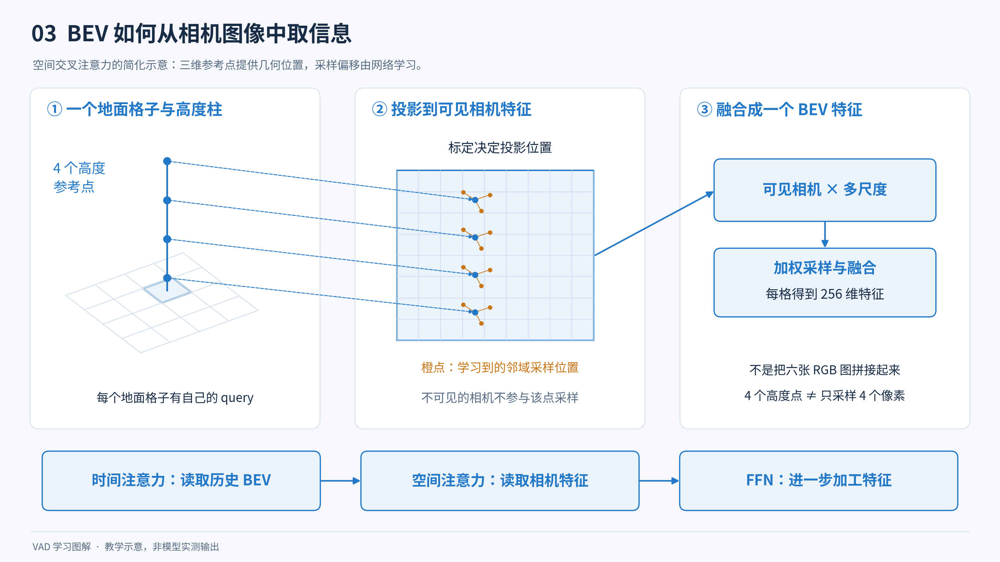

**图解 03｜BEV 不是把六张照片平铺起来。** 从左到右跟踪一个格子：沿高度生成参考点，利用标定投影到相机平面，在投影附近学习少量采样位置，最后汇集信息。图里只展开一个可见相机，实际还会融合其他可见相机与所用特征尺度。下方给出一个编码层的顺序；历史 BEV 的时序对齐与训练方式另外见图解 08。

#### 第三步：从 BEV 找到物体

300 个目标 query 是 300 个“候选槽位”，并不表示每帧真的有 300 辆车。目标 decoder 用 self-attention 让槽位彼此交流，再用可变形 cross-attention 从 BEV 读取内容，逐层更新目标中心参考点。

每一层输出两类结果：

- 类别分数：`[B, 300, 10]`，10 类包括 car、truck、construction_vehicle、bus、trailer、barrier、motorcycle、bicycle、pedestrian、traffic_cone。
- 三维框内部编码：`[B, 300, 10]`，实际顺序为 `(cx, cy, log w, log l, cz, log h, sin yaw, cos yaw, vx, vy)`。

这里有两个容易误读的细节。第一，输出的 10 个类别使用 sigmoid 分类，不会额外多出一个显式“背景通道”；背景监督由损失函数处理。第二，内部框编码维度是 10，不是部分注释写的 9。最终解码后把 sin/cos 合成一个角度，才变成常见的 9 维框。

目标中心最初是归一化参考坐标，进入输出框时恢复成米；宽、长、高使用对数编码；速度也是框输出的一部分。[VAD_head.py](../projects/mmdet3d_plugin/VAD/VAD_head.py) 第 567 行附近组装框，[core/bbox/util.py](../projects/mmdet3d_plugin/core/bbox/util.py) 给出准确的编码/解码定义。

训练时用匈牙利匹配决定“哪个 query 对应哪个真实目标”。例如标注中只有 8 个物体，300 个 query 中找到与这 8 个物体总体最匹配的 8 个，监督它们回归框和轨迹，其余 query 学习不要冒充目标。运动预测直接沿用检测匹配关系，不再建立一套独立的目标身份。

#### 第四步：从 BEV 画出矢量地图

地图预测有 100 个折线实例，每条 20 个点，因此总计 2,000 个地图点 query。采用 `instance_pts` 形式：每个点 query 是“该折线实例的 embedding + 该点序号的 embedding”。实例 embedding 告诉网络“属于哪条线”，点 embedding 告诉网络“在线上的第几个位置”。

地图 decoder 与目标 decoder 共用 BEV 特征，但有自己的参数。它预测三种地图要素：`divider` 分隔线、`ped_crossing` 人行横道、`boundary` 边界。每条线的 20 个点特征取平均后做类别预测；每个点单独回归归一化二维坐标。通过点集的最小和最大坐标，顺便得到包围该线的二维框。

最后的地图输出可以理解为 100 份这样的记录：

```text
类别候选：boundary
置信度：0.91
折线：[(x1,y1), (x2,y2), ... , (x20,y20)]
```

这比逐像素绘制一张语义分割图更适合直接计算“自车与边界距离”“目标与道路方向关系”。地图是模型从相机预测出来的；训练使用地图标注，不等于推理必须读取高清地图。

[MapDetectionTransformerDecoder](../projects/mmdet3d_plugin/VAD/VAD_transformer.py) 第 41 行；地图 query 构造在 [VAD_head.py](../projects/mmdet3d_plugin/VAD/VAD_head.py) 第 509 行附近；`map_transform_box()` 在第 815 行。

#### 第五步：预测每个目标可能怎样运动

同一辆车可能直行，也可能转弯。只预测一种未来很容易把不同可能性平均成一条现实中不会发生的轨迹。VAD 为每个目标生成 6 个候选未来。

实现步骤如下：

1. 取最后一层目标特征 `[B, 300, 256]`。
2. 每个目标特征与 6 个可学习的运动模式 embedding 相加，得到 `300×6=1,800` 个运动 query。
3. `motion_decoder` 让这 1,800 个 query 相互读取信息。配置把算子写成 `cross_attn`，但输入的 query、key、value 均来自运动 query，因此语义上是目标/运动模式之间的交互。
4. 地图点特征经过 `LaneNet`，把 `[B, 100, 20, 256]` 汇聚为 `[B, 100, 256]`。其基本做法是点级 MLP + 线内最大池化，再把线级信息拼回点特征，重复 3 次。
5. 对每个运动 query 选择置信度足够高、位置相对接近的地图线，执行 `motion_map_decoder`。这里地图阈值为 0.5，距离阈值 0.2 作用在归一化坐标上，不能直接读成 0.2 米。
6. 拼接交互前后的两组运动特征，得到 `[B, 300, 6, 512]`。
7. 轨迹 MLP 输出 `[B, 300, 6, 12]`，12 是未来 6 步的二维位移；另一个 MLP 输出 `[B, 300, 6]` 模式分数。

这些运动模式没有手工规定为“第 0 个直行、第 1 个左转”。它们通过训练形成不同未来假设；这一点与自车规划中的三个明确指令分支不同。

代码位置：[VAD_head.py](../projects/mmdet3d_plugin/VAD/VAD_head.py) 第 617 行到第 705 行附近；`LaneNet` 第 40 行；`select_and_pad_pred_map()` 第 1736 行。

#### 第六步：自车先看别人，再看地图，然后输出自己的轨迹

默认配置没有启用历史自车轨迹编码器：`ego_his_encoder=None`。因此初始自车 query 是一个可学习的 256 维向量。虽然数据管线仍然提供 `ego_his_trajs`，它没有被这一默认规划头用作历史轨迹特征。`ego_lcf_feat_idx=None` 又表示规划 MLP 不额外拼接速度等低维自车状态；但 CAN bus 已经在前面的 BEV 层进入模型，不能因此说模型完全不知道自车运动。

规划的交互顺序是：

1. 把每个目标的 `6×512=3072` 维运动特征，通过 `agent_fus_mlp` 压到 256 维。
2. 自车 query 对目标特征做 cross-attention，得到 `ego_agent_query`。
3. 用这个 query 再对地图线特征做 cross-attention，得到 `ego_map_query`。
4. 默认把两份自车特征拼接为 `[B, 1, 512]`，送入 `ego_fut_decoder`。
5. MLP 输出 36 个数，整理为 `[B, 3, 6, 2]`：3 个指令分支，每个分支 6 个二维未来位移。

默认 `query_thresh=0.0`、`query_use_fix_pad=False`，意味着规划交互中的 sigmoid 置信度筛选几乎保留全部有限值 query。不要与上一步运动与地图交互中 `map_thresh=0.5` 的筛选混为一谈。

自车三个分支的顺序在数据转换脚本中定义为：`0=右转，1=左转，2=直行`。`ego_fut_cmd` 是 one-hot 向量；例如 `[0,0,1]` 对应直行。数据转换脚本根据未来末端横向位移自动生成训练/评估指令：x ≥ 2 米为右转，x ≤ -2 米为左转，否则直行。它属于数据集中的指令生成方式，真实部署需要由导航/上层模块提供对应的指令。

关键代码：[VAD_head.py](../projects/mmdet3d_plugin/VAD/VAD_head.py) 第 708 行开始规划交互，第 790 行重排轨迹；[vad_nuscenes_converter.py](../tools/data_converter/vad_nuscenes_converter.py) 第 451 行开始生成指令；[VAD.py](../projects/mmdet3d_plugin/VAD/VAD.py) 第 423 行选择测试分支。

<a id="vad-figure-06"></a>

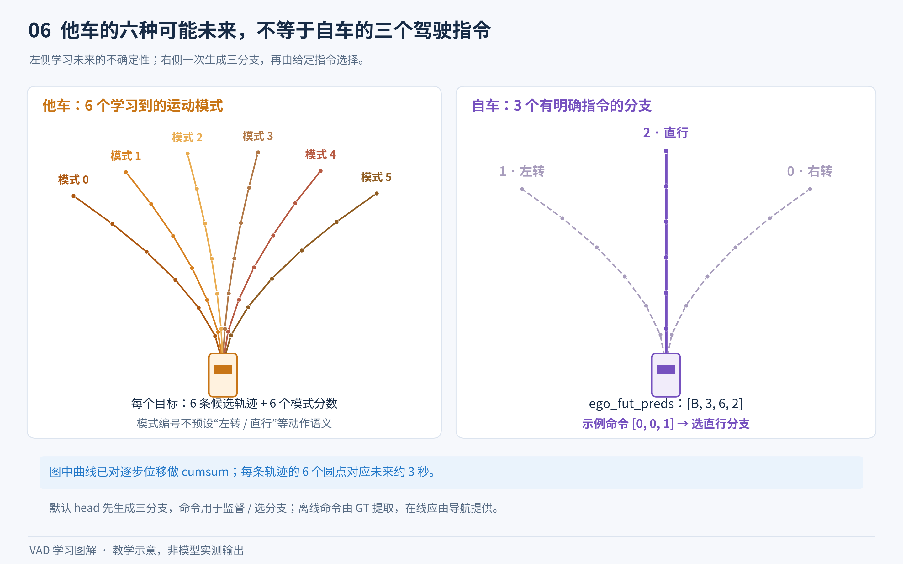

**图解 06｜两个“多条轨迹”解决不同问题。** 左边描述同一目标未来的不确定性：六个模式由训练形成，没有固定的“模式 0 就是左转”等语义。右边是给定导航意图下的三种自车规划分支，当前样本用 one-hot 命令选择其中一条。图中曲线已经做过位移累加，每条线上六个点对应六个未来时刻；它们只是教学形状，不代表网络一定输出如此整齐、互异的轨迹。

#### 位移与位置：新手最容易画错轨迹的地方

网络输出的是逐步二维位移，不是已经累加好的绝对位置。

例如输出三步 `[(0,1),(0,2),(1,2)]`，表示第一步向前 1 米、第二步再向前 2 米、第三步向右 1 米且向前 2 米。相对于当前自车原点的轨迹位置应是 `[(0,1),(0,3),(1,5)]`，即沿时间维做 `cumsum`。

- 自车：`ego_positions = ego_fut_preds[command_index].cumsum(-2)`。
- 周围目标：先将每个候选轨迹 `cumsum(-2)`，再加该目标当前预测框中心，才能放到同一张场景图上。

时间间隔是数据样本间隔，默认 6 步对应未来约 3 秒，测试代码用 2、4、6 步计算 1、2、3 秒指标。模型本身输出的是数值数组，不含方向盘角、油门、刹车，也没有在这个 VAD v1 主链中调用车辆控制器执行轨迹。

#### 张量尺寸速查

<a id="vad-figure-05"></a>


**图解 05｜把维度理解成“有几份、每份装什么”。** `B` 是 batch 大小，`D=256` 是常用隐特征维度；300 是目标容量，100×20 是地图实例数乘每条线的点数，300×6 是目标数乘运动模式数。自车只有一个初始 query，但 MLP 可以把它的交互特征展开成三个分支。图中多数输出展示末层切片；运动输出的层数维由复制形成，不能理解成每层都独立预测了一套新运动结果。

以下 `B` 是 batch size，`D=256`，`L=Tiny 3 / Base 6`，`A=300`，`P=100`，`S=20`，`M=6`，`T=6`。维度次序应以表中的实际张量为准，不同模块之间有 `permute`。

| 张量/对象 | Tiny | Base | 含义 |
|---|---|---|---|
| 训练图像 | `[B,3,6,3,H,W]` | `[B,4,6,3,H,W]` | 历史与当前帧组成的队列 |
| 当前图像 | `[B,6,3,H,W]` | 相同结构 | 六个 RGB 摄像头 |
| FPN 级数 | 1 | 4 | 每一级 `[B,6,256,h_l,w_l]` |
| BEV embedding 参数 | `[10000,256]` | `[40000,256]` | 每格一个可学习 query |
| BEV 编码器输出 | `[B,10000,256]` | `[B,40000,256]` | `get_bev_features()` 返回格式 |
| `outs['bev_embed']` | `[10000,B,256]` | `[40000,B,256]` | 完整 transformer 送给 decoder 后的格式，缓存测试历史 |
| 目标 embedding 参数 | `[300,512]` | 同左 | 拆成 query 内容和 query 位置，各 256 维 |
| 目标隐特征 | `[L,B,300,256]` | 同结构 | head 已经调整后的 `hs` |
| `all_cls_scores` | `[3,B,300,10]` | `[6,B,300,10]` | 各检测层的分类 logits |
| `all_bbox_preds` | `[3,B,300,10]` | `[6,B,300,10]` | 各检测层的框编码 |
| 地图点 embedding | `[2000,512]` | 同左 | 100 实例 × 20 点 |
| `map_all_cls_scores` | `[3,B,100,3]` | `[6,B,100,3]` | 地图实例分类 logits |
| `map_all_pts_preds` | `[3,B,100,20,2]` | `[6,B,100,20,2]` | 地图折线点，归一化到 [0,1] |
| `map_all_bbox_preds` | `[3,B,100,4]` | `[6,B,100,4]` | 从点集导出的二维包围框 |
| 运动 query | `[1800,B,256]` | 同左 | 每个目标 6 个未来模式 |
| 融合后的运动特征 | `[B,300,6,512]` | 同左 | 同时包含目标交互和地图交互 |
| 实际一次运动预测 | `[B,300,6,12]` | 同左 | 6 步 × 2 维位移 |
| `all_traj_preds` | `[3,B,300,6,12]` | `[6,B,300,6,12]` | 同一份运动结果复制到 L 维，不能误认为 L 套运动 decoder |
| `all_traj_cls_scores` | `[3,B,300,6]` | `[6,B,300,6]` | 运动模式 logits，同样复制 L 次 |
| 自车初始 query | `[B,1,256]` | 同左 | 默认可学习参数 |
| 自车规划 MLP 输入 | `[B,1,512]` | 同左 | 默认两份交互特征拼接 |
| `ego_fut_preds` | `[B,3,6,2]` | 同左 | 3 个指令分支、6 步二维位移 |

Tiny/Base 除 BEV 大小外，还分别使用 3/6 层 BEV encoder、3/6 层目标 decoder、3/6 层地图 decoder；运动/地图交互、自车/目标交互、自车/地图交互等 `CustomTransformerDecoder` 均为一层。

### 6.2 训练时到底发生了什么

#### 一个 iteration 的完整调用链

```text
框架传入一批已整理好的样本
└─ VAD.forward(return_loss=True)
   └─ VAD.forward_train(...)
      ├─ 把图像队列分成 历史帧 和 当前帧
      ├─ obtain_history_bev(历史帧)
      │  ├─ 临时 self.eval()
      │  ├─ torch.no_grad()
      │  ├─ extract_feat(所有历史图像)
      │  ├─ 按时间迭代 VADHead(..., only_bev=True)
      │  └─ 恢复 self.train()，返回历史 BEV
      ├─ extract_feat(当前帧)
      └─ forward_pts_train(...)
         ├─ VADHead.forward(...)，生成检测/地图/运动/规划预测
         └─ VADHead.loss(...)
            ├─ 检测匈牙利匹配与损失
            ├─ 根据检测匹配计算运动损失
            ├─ 地图匹配与损失
            └─ 自车模仿损失 + 规划约束损失
训练 runner / optimizer hook 汇总 loss、反向传播、梯度裁剪、更新参数
```

`forward_pts_train` 这个名称继承自三维检测框架，不表示这里处理的是点云。它接收到的是前面相机网络生成的图像特征。

#### 历史帧并不是一起完整反向传播

[obtain_history_bev](../projects/mmdet3d_plugin/VAD/VAD.py) 第 167 行明确使用 `torch.no_grad()`，历史帧只计算 BEV，没有检测、地图和规划任务输出，也不保留它们的反向计算图。得到的历史 BEV 作为当前帧的记忆输入。

所以默认训练行为是“借助历史信息预测当前帧，但只对当前帧这次前向链路做梯度更新”，不是将整个 3/4 帧队列端到端展开进行完整时间反向传播。历史分支与当前分支复用同一套权重；无梯度不等于额外存在一套永久冻结的历史网络。

时间注意力内部每次使用的是两份信息：上一份汇总 BEV + 当前 query。训练队列长度为 3/4，不表示一次 attention 直接维护 3/4 个独立完整历史 BEV。更早的信息通过递归汇总进入最近那份 BEV。

<a id="vad-figure-08"></a>

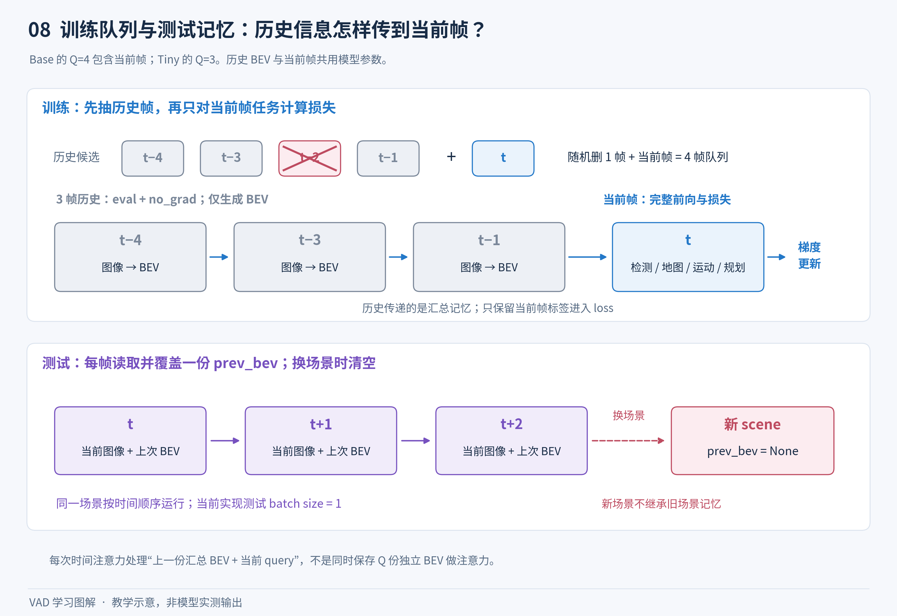

**图解 08｜记住过去，与对过去反向传播，是两回事。** 上半部分以 Base 的四帧队列为例，随机丢弃一个候选历史帧后，三张历史帧递推成一份记忆，当前帧才计算完整任务损失；图中丢弃的时刻只是一次采样示例。历史和当前复用权重，`no_grad` 不表示两套独立网络。下半部分说明测试按时间顺序缓存上一份 BEV，切换 scene 时清空；Tiny 的队列长度则是三帧。

#### 检测和地图的匹配为什么必要

模型输出的第 5 个 query 与标注的第 5 个对象并没有天然对应关系。匈牙利匹配寻找总成本最小的一一对应，使网络不会被迫遵守人为排列顺序。

目标匹配成本主要由分类成本和框 L1 成本组成。地图匹配还要解决“同一条线从头读到尾、从尾读到头，或者闭合线从不同起点开始采样”的表示差异，因此地图标注提供多种点序排列。匹配器同时选预测实例对应的标注实例和最佳点序，再用该点序监督点坐标。

代码定位：[VAD_head.py](../projects/mmdet3d_plugin/VAD/VAD_head.py) 第 845 行 `_get_target_single()`；第 931 行 `_map_get_target_single()`；具体成本和匹配器位于 `core/bbox/assigners/`、`core/bbox/match_costs/`。

#### 损失逐项解释

下面给出 tiny/base `e2e` 配置中的权重。权重数字只是乘数，不代表各任务实际贡献占比；损失自身的量纲、归一化方式和有效样本数量也会影响数值。

| 损失名 | 在教模型什么 | 默认 e2e 权重 |
|---|---|---:|
| `loss_cls` | 300 个目标槽位中哪些是物体、属于哪一类 | 2.0 |
| `loss_bbox` | 物体的位置、大小、朝向和速度要准确 | 0.25 |
| `loss_traj` | 被匹配到真实目标的最佳运动模式应接近真实未来位移 | 0.2 |
| `loss_traj_cls` | 给合适的未来运动模式更高分 | 0.2 |
| `loss_map_cls` | 这条地图线是什么类别 | 2.0 |
| `loss_map_pts` | 地图折线上的点应落在真实道路要素上 | 1.0 |
| `loss_map_dir` | 相邻地图点形成的方向应与标注一致 | 0.005 |
| `loss_map_bbox` | 地图实例包围框回归 | 0.0 |
| `loss_map_iou` | 地图实例包围框重叠程度 | 0.0 |
| `loss_plan_reg` | 自车所选指令分支模仿专家真实轨迹 | 1.0 |
| `loss_plan_bound` | 自车轨迹不要太贴近预测边界 | 1.0 |
| `loss_plan_col` | 自车轨迹远离预测车辆未来位置 | 1.0 |
| `loss_plan_dir` | 自车移动方向与附近道路分隔线方向相容 | 0.5 |

检测和地图的多层 decoder 都有辅助监督，日志中 `d0.loss_cls`、`d1.loss_map_pts` 等表示中间层损失。最终层使用没有 `dN.` 前缀的名称。

运动结果虽然被复制到 `all_traj_preds` 的每个检测层切片，而且 `loss_single()` 被逐层调用，但最终损失字典只保留最后一层的 `loss_traj`、`loss_traj_cls`；不会为每层加入独立的 `dN.loss_traj`。这一点直接见 [VAD_head.py](../projects/mmdet3d_plugin/VAD/VAD_head.py) 第 800 行和第 1605 行之后的损失组装。

配置中的检测 `loss_iou` 权重为零，而 `VADHead.loss_single()` 的有效检测回归实现本身就是框 L1，不能因为配置里存在 GIoU 字段，就把 GIoU 描述成这个模型的主要三维框优化目标。

#### 运动的“最佳模式”怎样选

[get_best_fut_preds / get_traj_cls_target](../projects/mmdet3d_plugin/VAD/VAD_head.py) 分别位于第 1302、1334 行。它们先将各模式的逐步位移累加成轨迹，再比较与标注轨迹的距离。**实际用于选择模式的是最后一个时间位置的距离，而不是整个轨迹平均距离。**

选到的模式用于轨迹 L1 回归，模式分类也以它作为正例；负目标 query 使用背景模式标签。未来无标注的时间步通过 mask 排除；`valid_fut_ts` 还可以进一步控制回归使用的预测时域。

应注意当前实现是先乘 `gt_fut_masks`，再取 `dist[..., -1]`。当最后一步无效时，各模式的最后步距离都被置零，并不是自动改取“最后一个有效时间步”。这是阅读/修改代码时要保留的实现事实，不能凭函数注释推断为理想化的最优模式规则。

#### 自车规划的模仿损失

训练数据里每个样本只有实际发生的一条专家轨迹和一个指令。例如实际是直行，就只对直行分支设置回归权重，右转/左转分支在该样本上不会因为偏离这条直行轨迹而被处罚。有效未来 mask 进一步排除缺失的标注时间步。

`loss_plan_reg` 比较的是逐步位移；以下三个几何约束在内部先 `cumsum`，使用累加后的未来位置。它们使用的是**模型预测的地图/目标/轨迹**，不是直接把完美标注场景塞给规划约束。

代码：[VAD_head.py](../projects/mmdet3d_plugin/VAD/VAD_head.py) 第 1108 行 `loss_planning()`，第 1629 行构造约束输入。

#### 三个规划约束究竟做了什么

<a id="vad-figure-12"></a>

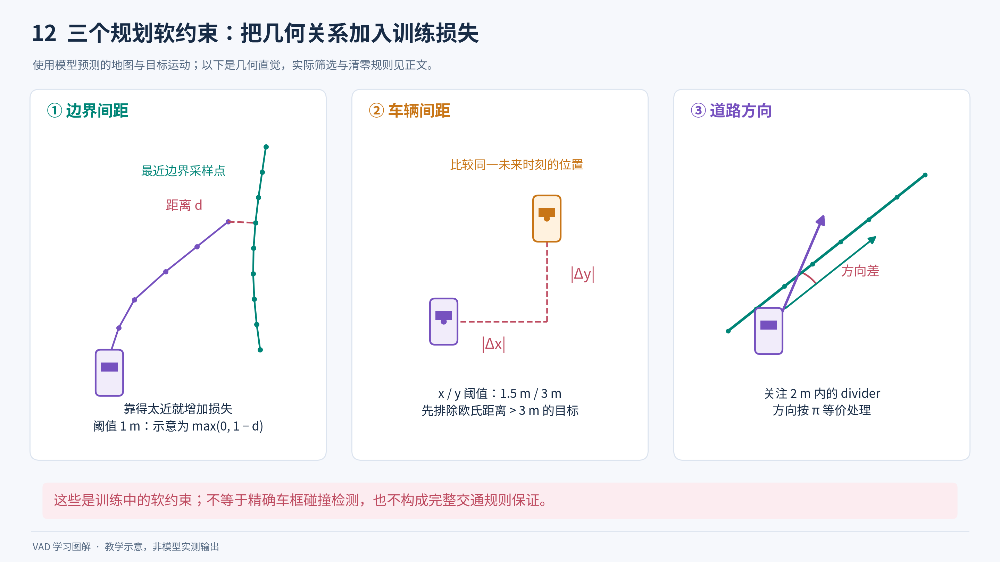

**图解 12｜让预测轨迹与预测场景的几何关系更合理。** 先分别观察自车与路边、自车与同一未来时刻车辆、自车方向与道路线段的关系。图展示局部几何直觉；实际还包含分数筛选、类别限制、模式选择和清零规则，下文逐项解释。尤其要注意：边界项使用采样点距离；车辆项不是精确车框检测；方向项按 π 等价处理。这三项是训练损失，不能当作后面离线碰撞评估算法或完整交通规则。

##### 边界约束 `PlanMapBoundLoss`

读取边界类别分数 ≥ 0.5 的预测地图折线，把点坐标从 [0,1] 恢复到米。计算自车未来点离预测边界采样点的最近距离，距离小于 1 米时给出随距离缩小而增大的处罚。

通俗例子：预测轨迹有一点离路边界 0.3 米，阈值为 1 米，几何项会产生约 0.7 的未加权距离惩罚；离边界超过 1 米时该项为零。

需要尊重的代码细节：它使用最近采样点距离，并非严格的点到连续折线距离；另外，检测到自车轨迹段与最近边界线段相交时，会将该相交时刻及之后的这项损失清零。不能把它描述成“对越界次数直接处罚”的完整硬约束。

[plan_loss.py](../projects/mmdet3d_plugin/VAD/utils/plan_loss.py)：类第 10 行，距离函数第 90 行，线段相交第 147 行，清零逻辑第 141 行。

##### 车辆碰撞距离约束 `PlanCollisionLoss`

筛选目标分类最高分 ≥ 0.5 的预测目标，仅保留类别索引 0～4；在本配置中是 car、truck、construction_vehicle、bus、trailer。对每个目标选运动模式分数最高的一个候选，把未来位移累加并加到当前目标中心。

然后过滤与自车该时刻欧氏距离超过 3 米的目标，用 x/y 方向的间距构造处罚，默认阈值分别为 1.5 米和 3 米。横向/纵向最小距离是分别挑选的，可能来自不同目标。

因此这是可训练的距离启发式约束，并非精确旋转车框碰撞检测；它没有在这里对行人、骑行者或所有 6 种运动未来一起做完整风险积分。**训练碰撞约束与后面评估使用的占用网格碰撞指标不是同一个算法。**

[plan_loss.py](../projects/mmdet3d_plugin/VAD/utils/plan_loss.py)：类第 180 行，车辆筛选第 245 行，底层 `plan_col_loss()` 第 263 行。

##### 道路方向约束 `PlanMapDirectionLoss`

筛选 divider 类别分数 ≥ 0.5 的预测分隔线。在每个未来自车点附近找一条线和相邻采样点，估计线段方向，再比较自车移动方向。只对附近 2 米内的线起作用，近似静止的轨迹不施加该项。

代码对角度差进行了 π 等价处理，因此主要约束沿道路几何方向运动，不应把这项损失宣传成完整的“单向道路合法行驶方向判断”。它也不涉及交通灯、限速、让行优先级等完整交通规则。

[plan_loss.py](../projects/mmdet3d_plugin/VAD/utils/plan_loss.py)：类第 320 行，`plan_map_dir_loss()` 第 392 行。

#### “端到端”里的梯度边界

这里需要分别看“数值向前传到哪里”和“梯度向后传到哪里”。两个模块前向相连，不等于所有中间量都可微；反过来，某处坐标 `detach` 也不代表整个感知网络被冻结。

<a id="vad-figure-11"></a>

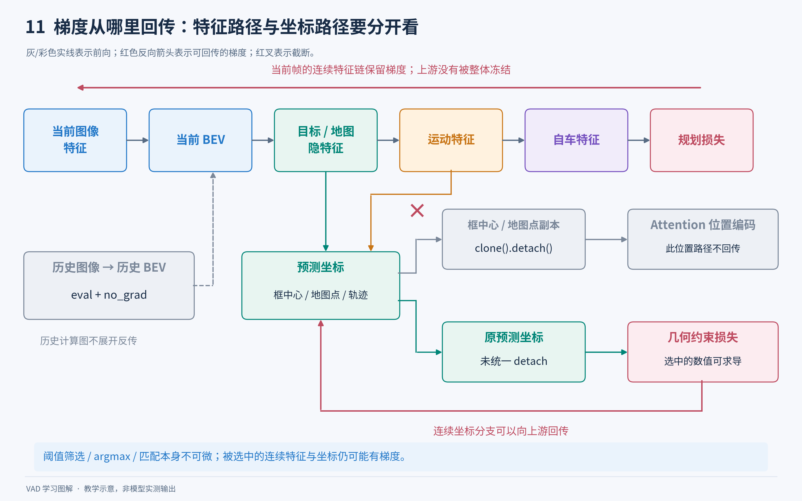

**图解 11｜同一个预测结果可以有不同用途、不同梯度路径。** 上方的特征链保留梯度；中间送入后续 attention 的框中心/地图点副本被 `detach`；下方直接送入几何约束的原预测坐标未被统一切断。红色箭头表示存在回传路径，不表示每个样本上的每个分支都有非零梯度。图省略了地图特征直接进入自车交互等支路，完整前向连接见图解 02；decoder 层间参考点的截断与预训练冻结项见下表及说明。

| 路径 | 当前实现 | 含义 |
|---|---|---|
| 当前帧图像 → BEV → 目标/地图特征 → 运动/规划特征 | 保留梯度 | 规划可通过特征链影响上游模型 |
| 历史图像 → 历史 BEV | `torch.no_grad()` | 不对历史帧展开反向传播 |
| 检测/地图 decoder 的层间参考点更新 | `new_reference_points.detach()` | 下一层以固定参考点值采样，避免沿此参考更新链回传 |
| 框中心和地图点送入后续 attention 的位置副本 | `clone().detach()` | 不通过这条位置编码/筛选路径更新坐标回归 |
| 地图特征 `map_hs`、目标特征 `hs` | 没有整体 detach | 下游任务仍然能更新共享特征 |
| 规划约束中的预测地图点、目标中心、目标未来位移 | 调用处没有统一 detach | 约束可以沿被选中的连续坐标分支回传到感知/运动预测 |
| 分类阈值筛选、argmin/argmax、匈牙利匹配 | 离散选择 | 选择本身不可微，不会通过“换一个下标”产生普通连续梯度 |

尤其不要误写成“规划约束的感知输入都被 detach”。[VAD_head.py](../projects/mmdet3d_plugin/VAD/VAD_head.py) 第 1629 行直接把原预测张量传给 `loss_planning()`；[plan_loss.py](../projects/mmdet3d_plugin/VAD/utils/plan_loss.py) 第 31 行只有边界损失定义了可选 `perception_detach`，且默认是 `False`，当前配置未启用。

模型也不是所有参数都从头训练。ResNet 使用 ImageNet 预训练入口 `torchvision://resnet50`，`frozen_stages=1`，BN 参数 `requires_grad=False` 且 `norm_eval=True`。两阶段训练的第二阶段开启规划损失、调整感知损失权重，但配置没有把整个感知模块设为冻结。

#### 单阶段与两阶段训练的差别

- `*_e2e.py`：60 个 epoch，感知、运动、规划损失从这一轮训练开始一起参与。
- `*_stage_1.py`：48 个 epoch，检测、地图和运动参与训练，四个规划损失权重均为 0。
- `*_stage_2.py`：12 个 epoch，通过 `load_from` 加载 stage 1 权重，开启规划损失，同时降低部分感知损失权重继续联合调整。

第二阶段不是“保持所有感知参数不动，只训练一个规划 MLP”。例如检测分类权重从 2.0 降到 0.8，框权重从 0.25 降到 0.1，地图分类权重从 2.0 降到 0.8，地图点权重从 1.0 降到 0.4，说明这些任务仍在优化。

第一阶段虽然规划损失权重为 0，现有 `forward()` 和 `loss()` 仍计算规划相关结果及约束表达式；不能将其理解为代码自动移除了规划分支或跳过了所有规划计算。

### 6.3 推理、结果解码和评估

#### 顺序视频推理的调用链

```text
VAD.forward(return_loss=False)
└─ forward_test(...)
   ├─ 检查 scene_token，换场景时清空 prev_bev
   ├─ 若 video_test_mode=False，则不用历史 BEV
   ├─ 由当前/前次 CAN bus 位姿计算位置和角度增量
   └─ simple_test(...)
      ├─ extract_feat(当前帧六相机)
      └─ simple_test_pts(...)
         ├─ VADHead.forward(..., prev_bev)
         ├─ VADHead.get_bboxes()
         │  ├─ CustomNMSFreeCoder：解码目标和对应运动轨迹
         │  └─ MapNMSFreeCoder：解码地图折线
         ├─ 包装预测结果
         ├─ 用 GT 计算运动和规划评估指标
         └─ 返回当前 bev_embed
   保存当前 BEV、位姿和 scene_token，供下一帧使用
```

训练每批样本有自己的有限历史队列；测试则把上一帧 BEV 缓存在 `prev_frame_info`，在同一场景中持续递推。场景转换必须清空缓存，样本应按时间顺序提供。不能把当前实现当成无状态、可随意乱序批处理的在线预测函数。

[VAD.py](../projects/mmdet3d_plugin/VAD/VAD.py) 第 256 行 `forward_test()`，第 315 行 `simple_test()`，第 356 行 `simple_test_pts()`。测试路径明确 `assert batch_size == 1`。

#### NMS-free 不是“没有后处理”

`CustomNMSFreeCoder` 使用最后一层目标分类分数，将 300×10 个类别候选展平后取 top-k，配置 `max_num=100`，再进行框中心范围筛选，同时索引对应目标的运动轨迹。它不用传统按框 IoU 抑制重复结果的 NMS，但仍然存在 top-k、阈值/范围筛选和坐标解码。

地图 coder 同样用末层分数取 top-k，配置最多 50 个地图实例，再把归一化地图点还原为米。实际输出数量可以小于配置上限。

源码：[fut_nms_free_coder.py](../projects/mmdet3d_plugin/core/bbox/coders/fut_nms_free_coder.py)，[map_nms_free_coder.py](../projects/mmdet3d_plugin/core/bbox/coders/map_nms_free_coder.py)；head 的 `get_bboxes()` 在 [VAD_head.py](../projects/mmdet3d_plugin/VAD/VAD_head.py) 第 1698 行。

结果中的主要字段：

| 字段 | 内容 |
|---|---|
| `boxes_3d`、`scores_3d`、`labels_3d` | 三维检测框、分数和类别 |
| `trajs_3d` | 被选中目标的 6 模式未来逐步位移 |
| `map_boxes_3d` | 地图线点集的二维包围框；字段名含 3d，不代表这些地图框真的有高度 |
| `map_scores_3d`、`map_labels_3d` | 地图类别分数和标签 |
| `map_pts_3d` | 地图折线点，实际为二维坐标 |
| `ego_fut_preds` | 三个指令分支的未来逐步位移 `[3,6,2]` |
| `ego_fut_cmd` | 当前样本的 one-hot 指令 |
| `metric_results` | 当前样本的运动/规划评估统计量，位于外层结果字典 |

#### 当前测试接口混合了预测和评估

`VADHead.forward()` 生成预测不需要未来 GT；但仓库当前 `VAD.forward_test()` / `simple_test_pts()` 在一次调用中同时计算指标，因此需要传入真实目标框、真实未来轨迹等评估数据。它不是已经剥离标注依赖的部署服务接口。

若未来接入真实车辆，需要把纯前向预测、指令选择、结果解码从“读取 GT 算指标”的代码中拆开，再接轨迹跟踪控制器。本次文档只解释现有实现，不表示仓库已经提供这一部署闭环。

#### 运动评估看什么

`simple_test_pts()` 用 0.6 检测分数阈值筛选一份预测副本用于运动评估，不是先把最终全部检测输出统一裁剪到 0.6。然后按预测/真实目标中心做一一匹配，距离阈值为 2 米。

运动统计主要报告 `car` 和 `pedestrian`；其中 car、truck、bus、trailer 合并到车辆类。construction_vehicle、barrier、traffic_cone、motorcycle、bicycle 不计入这里的运动类别汇总。

- ADE：未来各时刻位置误差的平均值。
- FDE：最后时刻的位置误差。
- minADE/minFDE：对 6 个候选模式取最优误差，评估的是候选集是否覆盖真实未来；不同指标的最优模式可能不同。
- MR：末端误差超过阈值的比例。
- EPA 的相关计数：同时考虑漏检、误检和轨迹命中，具体总体汇总在数据集 `evaluate()` 中完成。

匹配后，运动评估先累加未来位移，再分别加预测框中心和真实框中心。因此检测中心偏差也会影响最终场景坐标系里的轨迹误差。

[VAD.py](../projects/mmdet3d_plugin/VAD/VAD.py) 第 468 行 `assign_pred_to_gt_vip3d()`，第 509 行 `compute_motion_metric_vip3d()`。

#### 规划评估看什么

规划先按指令选择一个分支，再 `cumsum` 转成未来位置。`compute_planner_metric_stp3()` 针对 1/2/3 秒分别使用前 2/4/6 步。

**这里的 `plan_L2_1s/2s/3s` 是截至该时域的平均位置误差，不是恰好在 1/2/3 秒终点的一次误差。** 这一点可直接由 [metric_stp3.py](../projects/mmdet3d_plugin/VAD/planner/metric_stp3.py) 第 290 行 `compute_L2()` 确认。

碰撞评估不是使用模型预测出来的占用图，而是把真实交通参与者未来框栅格化为占用标签：范围 `[-50,50]×[-50,50] 米`，分辨率 0.5 米，所以是 `200×200`。这个评估栅格与网络的 Tiny/Base BEV 网格不是一回事。

- `plan_obj_col`：轨迹参考点落入占用区域的情况。
- `plan_obj_box_col`：把固定自车矩形平移到轨迹点，检查其覆盖区域是否与占用相交。

自车车宽 1.85 米、车长 4.084 米，矩形参考点还包含 0.5 米偏置；此实现不根据轨迹切线逐步旋转自车矩形。参与者占用包含车辆和行人；其类别筛选与训练 `PlanCollisionLoss` 的“0～4 类车辆”条件不同。代码还会排除真实自车轨迹本身已经发生碰撞的对应时间点。

未来标注不完整的样本通过 `fut_valid_flag` 标记，相关指标在此函数里置零并携带有效标记，后续汇总必须按有效样本数处理，不能把这些零当成完美预测。

这些是基于日志数据的开环指标：模型的预测并没有真正改变后续相机观测和其他车辆行为。轨迹误差小或离线碰撞率低，不等于已经验证了闭环驾驶安全性。

### 6.4 模型实现中的阅读注意点

以下是静态源码观察，不是本次运行训练后发现的实验结论；不建议新手为了“看起来更合理”而直接修改这些位置。

1. **源码注释可能滞后。** 例如某些 docstring 仍写框维度 9 或地图框 3D、写“after nms”，但实际代码分别是 10 维内部框编码、二维地图和 NMS-free top-k。读张量操作比只读注释可靠。
2. **历史参考点有作者主动保留的问题。** [encoder.py](../projects/mmdet3d_plugin/VAD/modules/encoder.py) 第 186 行明确注释：`shift_ref_2d` 应先 clone，但为复现结果保留别名修改。当前 `shift_ref_2d += shift` 同时改变 `ref_2d`；不能把代码讲成已修复版本。
3. **Tiny 的历史旋转中心需要核查。** [VAD_transformer.py](../projects/mmdet3d_plugin/VAD/VAD_transformer.py) 默认 `rotate_center=[100,100]`，当前 tiny 配置 BEV 为 100×100 且未覆盖此值。静态看它没有随 Tiny 网格自动缩放到中心，实际影响需要专项验证；本文不宣称已测量其误差。
4. **地图实例代表点按当前代码是离归一化原点最近的点。** `select_and_pad_pred_map()` 以及自车地图交互中先对已归一化的地图点计算 `sqrt(x²+y²)`，再选最小值。归一化坐标中的 `(0,0)` 对应感知区域角落，通常不是自车的 `(0.5,0.5)`；不要仅凭注释称它为“离自车最近的点”。之后才根据目标位置计算相对距离。
5. **损失中的 inplace 修改需要谨慎。** `PlanCollisionLoss.forward()` 会将无效目标对应的 `agent_fut_preds` 原地设为大数。修改训练分支、复用这些张量或调整梯度路径前，应检查 autograd 和张量别名；本文没有进行 GPU 反向运行来确认所有改法。
6. **测试当前只支持 batch size 1。** 全局 `prev_frame_info` 也只有一份场景状态；改大测试 batch 不能只修改配置中的数字。
7. **并非所有参数组合都实现完整。** `motion_decoder=None` 明确抛 `NotImplementedError`；规划逻辑实际还依赖 ego-agent/ego-map decoder。某些 `as_two_stage` 注释和参数来自通用 DETR，但当前主配置为 `False`，源码里有未完善的 encoder loss 分支，不能据此承诺任意切换都可运行。
8. **默认参数不等于推荐配置。** `VADHead.__init__` 中规划损失的旧默认类型名与当前注册实现不完全一致，正式配置显式指定 `PlanCollisionLoss`、`PlanMapDirectionLoss`。学习/运行应从已提供配置出发。
9. **缺少完整驾驶控制和闭环仿真。** 本主链的最终动作是未来位置序列，没有在这里完成车辆动力学可行性验证、控制器执行或交通规则全覆盖。

## 7. 训练框架与真实调用链

### 7.1 用通俗语言理解这套工程

可以把训练流程想象成一条流水线。`config` 是总装配单，说明选什么网络、用什么数据、每次送多少样本、训练多少轮。`dataset` 负责找到一个样本，`pipeline` 负责读取图片、缩放、归一化和整理标签，`dataloader` 把样本分批送给模型。`model` 做预测，`loss` 衡量预测错了多少，`optimizer` 根据梯度修改参数。`runner` 是重复执行这些步骤的调度员，`hook` 是调度员在不同时间点调用的小助手：例如更新学习率、保存模型或验证模型。

`epoch` 是训练集被遍历一轮；`iteration/iter` 是取一个 batch 做一次更新；`batch` 是同一次前向运算中的样本集合。VAD 一个样本里本身又有多个时间帧和六个相机，因此“batch 中两个样本”“一个样本四帧”“每帧六张图”是三个不同层级，不能混为一谈。

注册器 `registry` 就像“名字 → 类”的通讯录。配置写 `type='VAD'`，框架并不会自己猜它在哪个文件。必须先 `import projects.mmdet3d_plugin`，执行类上的注册装饰器，将 `VAD` 登记到 `DETECTORS`，`build_model` 才能按名字实例化它。head、attention、decoder、loss、assigner 等也采用同样方式。**目录里有文件、文件已导入注册、配置选择了某个类、类实际参与计算，是四件不同的事。**

定位：[插件主入口](../projects/mmdet3d_plugin/__init__.py)、[VAD 包入口](../projects/mmdet3d_plugin/VAD/__init__.py)、[训练总入口](../tools/train.py)。

### 7.2 真实训练调用链

<a id="vad-figure-10"></a>

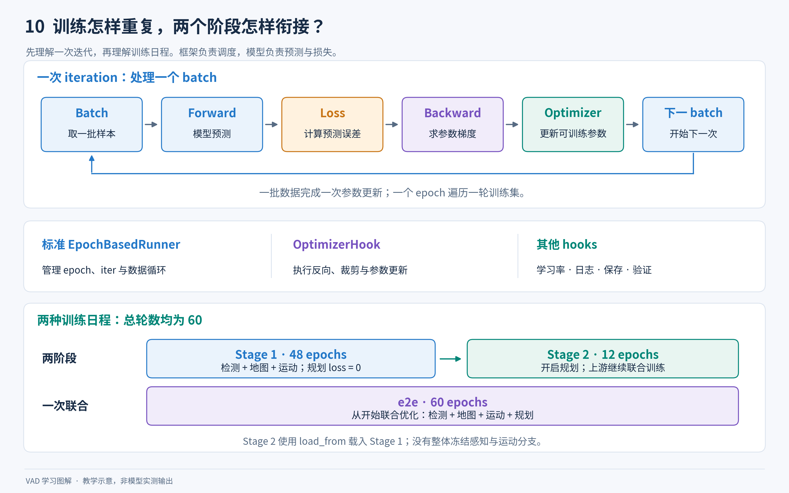

**图解 10｜先理解训练在重复什么，再追函数调用。** 一次 iteration 完成取数据、前向、损失、反向和参数更新，一个 epoch 则遍历一轮训练集。中部把框架职责与模型计算分开，下部对比 `48+12` epochs 的两阶段方案和 `60` epochs 的 e2e 方案。Stage 2 加载 Stage 1 权重并开启规划监督，上游仍参与联合训练；这与从 checkpoint 恢复同一阶段的优化器和进度不是一回事。

```text
bash tools/dist_train.sh CONFIG GPU_NUM
  └─ torch.distributed.launch：每张 GPU 启动一个 Python 进程
      └─ tools/train.py::main（108 行）
          ├─ Config.fromfile：读取配置，合并 _base_ 继承
          ├─ merge_from_dict：合并 --cfg-options
          ├─ import 自定义插件：注册数据集、网络、损失等
          ├─ init_dist / 随机种子 / work_dir / 环境日志
          ├─ build_model(cfg.model) → VAD → VADHead → 子模块
          ├─ model.init_weights()
          ├─ build_dataset(cfg.data.train)
          └─ VAD/apis/train.py::custom_train_model（5 行）
              └─ VAD/apis/mmdet_train.py::custom_train_detector（23 行）
                  ├─ build_dataloader：sampler + batch + collate
                  ├─ MMDistributedDataParallel / MMDataParallel
                  ├─ build_optimizer（90 行）
                  ├─ build_runner（104/114 行）
                  ├─ register_training_hooks（137 行）
                  ├─ DistSamplerSeedHook（148 行）
                  ├─ 验证 hook（150 行）
                  ├─ custom_hooks（176 行）
                  ├─ resume / load_checkpoint（190 行）
                  └─ runner.run(data_loaders, cfg.workflow)（194 行）
                      └─ 框架标准 EpochBasedRunner
                          ├─ before_train_epoch → VAD.set_epoch
                          ├─ dataloader 取 batch
                          ├─ model.train_step（继承的框架入口）
                          │   └─ VAD.forward(return_loss=True)
                          │       └─ VAD.forward_train
                          │           ├─ 历史帧 no_grad 生成 prev_bev
                          │           ├─ 当前帧提取图像特征
                          │           └─ forward_pts_train
                          │               └─ VADHead.forward → VADHead.loss
                          ├─ 框架聚合 loss、log_vars、num_samples
                          └─ optimizer hook：清梯度、反向、裁剪、参数更新
```

这里最容易误解的是：`VAD.forward_train()` 返回的是损失字典，里面通常没有直接写 `loss.backward()`。这不是“漏写反向传播”，而是模型只负责算损失，框架继承的 `train_step` 负责解析损失，optimizer hook 在规定的时机负责执行参数更新。类似地，保存模型、打日志和调整学习率也无需写在 VAD 的每次前向里。

**当前六份 VAD 配置全部使用框架标准 `EpochBasedRunner`，不是仓内的 `EpochBasedRunner_video`。** 仓内 video runner 会把序列拆开，用外部 `eval_model` 无梯度推历史，再训练最后帧；当前 VAD 已在 `VAD.forward_train` 内部处理历史，不走这个旧流程。导入并注册了 `EpochBasedRunner_video` 并不代表它被使用。

主线文件：[train.py](../tools/train.py)、[VAD 训练 API 包装](../projects/mmdet3d_plugin/VAD/apis/train.py)、[训练组装实现](../projects/mmdet3d_plugin/VAD/apis/mmdet_train.py)、[VAD 模型](../projects/mmdet3d_plugin/VAD/VAD.py)。

#### 配置、环境与保存目录

训练入口先读配置和命令行覆盖，再设置分布式环境和 seed，创建输出目录，保存展开后的配置和环境信息。`work_dir` 优先级是命令行 `--work-dir` > 配置的 `work_dir` > `work_dirs/<配置文件名>`。日志会记录框架版本、环境和随机种子，checkpoint 的 meta 还包含完整配置及类别信息，方便以后确认“这份权重到底对应哪个设置”。

模型通过 `build_model` 构造之后会先 `init_weights()`。图像骨干预训练与后面加载整模型 checkpoint 处于不同阶段，不要把它们理解为同一件事。后面 `runner.load_checkpoint` 若提供了权重，会覆盖 checkpoint 对应的模型参数。

shell 脚本训练默认端口是 `28509`，测试是 `29503`，可通过 `PORT` 环境变量覆盖。`dist_train.sh` 固定加 `--deterministic`，也会把额外参数继续传入 Python。当前仓库路径中 `code ` 带空格，切换工作目录应加引号，例如 `cd '/home/idriver/E2E/code /VAD'`，之后用仓库内相对路径启动。

#### 优化器与学习率

`VAD/apis/mmdet_train.py:90` 使用 `cfg.optimizer` 构建优化器；配置不是注释，实际决定模型怎样更新。

当前六份 VAD 配置的共同行为是：AdamW 主学习率 `2e-4`，权重衰减 `0.01`，图像骨干 `lr_mult=0.1`，所以骨干学习率是 `2e-5`。可以把这理解为：骨干已有预训练知识，因此改变得稍慢；新增任务分支可以学得快些。梯度裁剪 `max_norm=35, norm_type=2` 用来限制一次更新前梯度的整体幅度。

学习率为余弦下降，前 `500` 次迭代采用线性 warmup，从基准学习率的 `1/3` 上升，最低学习率比例 `1e-3`。warmup 像起步时缓慢加速，避免随机初始化的新增分支让参数一开始变动过猛。

`tools/train.py:169` 只在 **PyTorch 版本恰好为 1.8.1** 且原配置为 AdamW 时改成仓内 `AdamW2`，这是历史兼容代码，不是 VAD 新提出的优化方法。AdamW2 内部仍调用 PyTorch 旧版 `_functional.adamw`。

`VAD/apis/mmdet_train.py:127` 提供 fp16 optimizer hook 的分支，但当前 VAD 配置中的 `fp16` 行被注释。因此只能说代码提供兼容入口，不能说默认训练已经使用半精度。可变形注意力代码中也有主动选择 fp32 的数值稳定处理。

#### Runner 和 Hook 分别做什么

| 组件 | 触发时间与职责 |
| --- | --- |
| 学习率 hook | 根据全局 epoch/iter 更新 optimizer 的学习率。 |
| optimizer hook | 在得到当前 batch 的 loss 后清梯度、反向传播、执行裁剪和 optimizer.step。 |
| checkpoint hook | 按配置间隔保存权重和训练状态；当前每个 epoch 保存一次。 |
| TextLoggerHook | 当前配置每 100 iter 打印/写入训练指标。 |
| TensorboardLoggerHook | 将训练曲线写成 TensorBoard 可读取事件。 |
| DistSamplerSeedHook | 分布式按 epoch 更新采样随机状态，使不同轮不总是同一顺序。 |
| CustomSetEpochInfoHook | 每轮开始时将当前 epoch 传给 VADHead，供可选轨迹损失 warmup 等逻辑使用。 |
| CustomDistEvalHook | 在配置要求的时机跑验证集、汇总指标，支持配置保存最优模型。 |
| TransferWeight | 为旧的双模型 video runner 复制训练模型权重给 eval_model；默认配置未使用。 |
| GradChecker | 打印需要梯度但没有 grad 的参数名称，辅助调试；默认配置未使用。 |

`CustomSetEpochInfoHook.before_train_epoch` 位于 `VAD/hooks/custom_hooks.py:20`。它先去掉 `MMDataParallel`/DDP 包装，再调用 `VAD.set_epoch`；后者在 `VAD.py:643` 将 epoch 写到 head。这里“传了 epoch”不等于“所有配置都启用了轨迹 warmup”，是否启用仍看 head 的开关。

验证与训练循环 `workflow` 是两回事。即使 `workflow=[('train', 1)]`，只要注册了评估 hook，也能定期验证。当前配置的 `evaluation.interval=total_epochs`，默认是在训练结束那一轮才做验证，不是每轮都做。`--no-validate` 会关闭训练过程的验证 hook。

#### 恢复训练与加载预训练权重

`VAD/apis/mmdet_train.py:190` 的优先级是 `resume_from` > `load_from`。框架中 resume 的含义是尽量恢复上次训练的模型、optimizer 与迭代进度；load_checkpoint 主要用于加载模型权重，不延续原阶段训练进度。第二阶段配置中的 `load_from=第一阶段权重` 表示以第一阶段为初值开始一个新阶段，不应写成“从第一阶段 epoch 继续累加”。

注意 `tools/train.py:162` 只有当 `--resume-from` 给出的文件确实存在才覆盖配置；文件名拼错时在这一行不会直接报文件不存在，需要检查日志是否真的执行了恢复。

### 7.3 测试与训练内验证调用链

```text
bash tools/dist_test.sh CONFIG CHECKPOINT GPU_NUM
  └─ torch.distributed.launch → tools/test.py::main（120 行）
      ├─ 读配置、导入插件、设置 test_mode=True
      ├─ build_dataset + build_dataloader(shuffle=False)
      ├─ build_model + load_checkpoint
      └─ VAD/apis/test.py::custom_multi_gpu_test（40 行）
          ├─ model.eval() + torch.no_grad()
          ├─ model(return_loss=False, rescale=True, **data)（66 行）
          │   └─ VAD.forward → forward_test → simple_test → simple_test_pts
          │       └─ VADHead.forward / get_bboxes / 运动与规划结果
          ├─ 每个 rank 累积自己的样本结果
          └─ collect_results_cpu（111 行）
              ├─ 各 rank 写 part_<rank>.pkl
              ├─ rank 0 按 rank 连续拼接，去掉补齐样本
              └─ 返回 {'bbox_results': 所有样本结果列表}
      ├─ --out：保存原始 pickle 结果
      ├─ --format-only：dataset.format_results
      └─ --eval：dataset.evaluate
```

`model.eval()` 是切换 Dropout、BN 等层的行为；`torch.no_grad()` 是不建立反向梯度图，减少内存和计算。两者目的不同，测试通常同时使用。训练中处理历史帧也可以临时用 eval/no_grad 计算历史 BEV，但当前帧仍正常训练。

VAD 推理会缓存历史 BEV。同一 scene 连续帧到来时使用历史，新 scene 到来清空缓存。采样和结果合并必须配合这种时序性：自定义分布式 sampler 把**连续的一段样本**分给每张卡，所以 `collect_results_cpu` 采用“rank 0 一段 + rank 1 一段”顺序拼接，不采用一般分布式测试常见的交替插入。若一个 scene 在卡间切开，新卡开始处理时不会拥有另一张卡的历史缓存。

非分布式 `tools/test.py:237` 调用外部 MMDetection3D 的 `single_gpu_test`，分布式 `:243` 调本仓 `custom_multi_gpu_test`。两者结果格式不同是当前接口问题的重要来源，不能把它们画成完全相同的一条路径。

训练内评估 hook 位于 [core/evaluation/eval_hooks.py](../projects/mmdet3d_plugin/core/evaluation/eval_hooks.py)，`CustomDistEvalHook._do_evaluate:54` 在满足 interval 时同步 BN 统计量并调用 VAD 多卡测试；主进程交给继承的 evaluate 流程计算指标；若配置 `save_best` 则保存最优 checkpoint。它也受到下节描述的结果类型问题影响。

测试主线定位：[tools/test.py](../tools/test.py)、[VAD/apis/test.py](../projects/mmdet3d_plugin/VAD/apis/test.py)。

### 7.4 当前源码中的遗留问题与阅读陷阱

以下是**静态代码检查发现**，不表示已经通过实际训练验证其影响。文档描述当前实现，算法和接口保持原样。

#### 应先关注的直接接口问题

1. **分布式评估接收的不是预期列表。** `VAD/apis/test.py:107` 返回 `{'bbox_results': list}`；`tools/test.py:246` 又包装一层相同键，随后 `:274` 传给 `dataset.evaluate` 的仍是内层 dict。`nuscenes_vad_dataset.py:1781` 却直接 `results[i]['metric_results']` 按整型取样本，没有先解包。`format_results:1581` 确实可以解包 dict，但 evaluate 的循环早于 format_results，因此这个支持来不及生效。训练 CustomDistEvalHook 也把同一字典直接交给评估流程。修复方向应是统一边界数据类型，或在 evaluate 入口统一解包，不能把当前脚本写成“已保证可直接复现”的教程。
2. **`--gpu-collect` 返回 None。** `VAD/apis/test.py:158` 的 collect_results_gpu 调用了 collect_results_cpu 却没写 `return`。默认 `gpu_collect=False` 可避开该分支。所谓 CPU 收集只是结果经文件汇聚，默认临时目录广播仍创建 CUDA tensor，并不表示整个算法可以在 CPU 上跑。
3. **训练内验证 batch > 1 明确禁止。** `VAD/apis/mmdet_train.py:154` 直接 `assert False`；推理缓存也大量使用首个样本信息。新手应保持测试/验证每卡一个样本，不能只看到一些函数有 batch 维就认定支持任意 batch。
4. **旧 video runner 不可直接替换默认 runner。** `VAD/runner/epoch_based_runner.py` 构造函数直接 `self.eval_model.eval()`，而默认 eval_model=None；标准 tools/train.py 没有为它创建独立评估模型。当前配置不用它正是关键区别。
5. **`--autoscale-lr` 的 GPU 数时机。** `tools/train.py:171` 在 init_dist 获取真实 world_size 之前，使用初始 cfg.gpu_ids 的长度缩放学习率。常规分布式启动而没有额外指定 GPU 数时，它可能按初始单卡数缩放，不能当作自动感知卡数的可靠开关。

#### 保留目录和辅助脚本不是“全部可直接运行”

- **重复注册。** 顶层插件只导入 VAD；bevformer 与 VAD/modules 存在相同 registry 名称。额外直接 import bevformer 可能因重复类名注册而失败。不要为了“导入所有代码”而全包一起 import。
- **BEV 偏移保留问题。** `VAD/modules/encoder.py:186` 的注释明确写“应该用 ref_2d.clone，但为复现论文保留”；`:187` 的 `shift_ref_2d = ref_2d` 随后原地 `+=`，使原始 ref_2d 也改变。文档应同时讲理想的时序对齐思想和当前实现特征，不能默默当成没有问题。
- **benchmark.py 的旧 import。** 它从 `projects.mmdet3d_plugin.datasets` 导入 custom_build_dataset，但该包仅导出 VADCustomNuScenesDataset；正确函数在 datasets/builder.py。另有 --samples/--log-interval 未设 type=int 和尾次耗时重复累加，适配后再做速度结论。
- **get_flops.py 的 dummy forward。** 脚本把 model.forward 换成 model.forward_dummy，接着传 rescale、img_metas 等关键字；当前 VAD.forward_dummy(self, img) 只接收 img，而且内部元数据设为 None，接口不一致。即使适配了调用，普通模块 hook 也不能保证统计所有可变形 CUDA 注意力及函数式运算。脚本实际从 dataset 取第一条样本，因此 --shape 也不是模型真实输入尺寸的完整控制入口。
- **get_params.py 的路径占位。** YOUR_CKPT_PATH=None 需要替换；它统计 state_dict 全部张量元素，可能含 BN 等 buffer，不能当严格可训练参数数。
- **misc/browse_dataset.py 的通用假设。** 只按固定数据集名分支，未列 VADCustomNuScenesDataset；普通单图、点云数据结构不适用于整个时序多相机样本。misc/visualize_results.py 也没有像训练入口一样做 plugin 导入，不能认为会自动绘出 VAD 规划。
- **专用 visualization.py 的输入格式。** 需要 format_results 输出的、包含 results/map_results/plan_results 的结果文件，不是任意 --out 原始 pickle。它默认用 nuScenes trainval 和 ./data/nuscenes；合成视频设 10 FPS，这不是数据标注时间频率。VideoWriter 在循环创建目录之前初始化，使用前预先创建输出目录更稳妥。
- **旧启动与旧依赖。** shell 用 torch.distributed.launch 和 --local_rank，代码依赖旧 MMCV runner/registry。GridMask 和训练 API 直接 .cuda()，注意力 import 时加载 MMCV `_ext`；局部有 PyTorch CPU fallback 不代表完整项目支持纯 CPU。
- **无效参数和未启用入口。** tools/test.py 的 --json_dir 保存实现已注释，传它不会生成 metric_record.json。tools/train.py 只在 plugin=True 分支导入 custom_train_model，因此它不是所有普通 MMDetection 配置都能使用的无条件通用入口。

### 7.5 BEVFormer 目录为何存在，哪些代码真正使用

BEVFormer 的基础作用是“多相机图像 + 历史 → BEV 鸟瞰特征 → 3D 检测”。VAD 延续 BEV 编码方式，进一步输出地图向量、周围交通参与者未来轨迹、自车规划。当前仓库保留了完整旧 bevformer/ 基础检测实现，但真正 VAD 模型是独立的 VAD/VAD.py 和 VAD/VAD_head.py，不是先运行另一个 BEVFormer 再把最终检测框交给 VAD。

对两个 modules 目录的 7 个同名 .py 文件逐一对照，**除文件头注释外实现相同**：transformer、encoder、decoder、spatial_cross_attention、temporal_self_attention、custom_base_transformer_layer、multi_scale_deformable_attn_function。VAD 主线注册的是 VAD/modules 副本。旧 runner 和 test API 也主要只有文件头差异；VAD 训练 API 修正了 custom_build_dataset 的导入路径；VAD hooks 额外增加 CustomSetEpochInfoHook。

| BEVFormer 文件 | 作用和关键入口 |
| --- | --- |
| detectors/bevformer.py | 基础检测器，图像骨干/neck、历史 BEV 缓存、训练与测试分派；forward_train:179、forward_test:233。 |
| detectors/bevformer_fp16.py | 旧半精度变体，接收外部 prev_bev；val_step:78 特殊用于历史 BEV 生成，配合旧 video runner。 |
| dense_heads/bevformer_head.py | 仅目标检测的 head：查询、分类/框回归、匈牙利匹配、逐层监督和框解码；forward:131、loss:410、get_bboxes:497。 |
| modules/transformer.py | PerceptionTransformer，加入相机、尺度、CAN bus 编码，对齐历史 BEV，串起 BEV encoder 和目标 decoder；get_bev_features:104。 |
| modules/encoder.py | 生成 3D/2D 参考点，用 lidar2img 投影采样；BEVFormerLayer 组织时序注意力、空间注意力、FFN；point_sampling:93。 |
| modules/spatial_cross_attention.py | 按相机可见性重排 BEV query，在不同高度投影参考点附近采样特征，再合并各相机结果。 |
| modules/temporal_self_attention.py | 当前 query 与历史融合 BEV 交互；内部队列固定为 2，指“历史融合结果 + 当前”，不等于原始图像序列只能两帧。 |
| modules/decoder.py | 从 BEV 解码目标，逐层更新参考点；CustomMSDeformableAttention 在 BEV 稀疏采样。 |
| modules/custom_base_transformer_layer.py | 按 operation_order 组合注意力、归一化和 FFN 的通用积木。 |
| modules/multi_scale_deformable_attn_function.py | MMCV 已编译可变形注意力的 PyTorch autograd 包装，连接 forward/backward；不是自有 CUDA 内核源码。 |
| apis/train.py | 旧模型训练分派包装，当前入口使用 VAD 版本。 |
| apis/mmdet_train.py | 旧训练管理流程，保留过时 import，当前未使用。 |
| apis/test.py | 旧多卡测试与结果收集，当前未使用，也保留 gpu_collect 无返回问题。 |
| runner/epoch_based_runner.py | 外部 eval_model 推历史、训练模型只训末帧的旧 runner。 |
| hooks/custom_hooks.py | TransferWeight，为旧 runner 同步两套模型权重。 |
| 各级 __init__.py | 导出类并触发注册；目录存在不代表会自动执行。 |

沿用名称也要辨认：`pts_bbox_head` 和 `forward_pts_train` 来自 3D 检测框架历史命名，VAD 当前调用传入的通常是多相机图像特征，不能按 `pts` 字面解释成“肯定用了点云网络”。

### 7.6 全部 __init__.py 主注册链

Python 导入一个子包里的具体文件前，通常先执行父包 `__init__.py`。所以顶层只写“导入某个类”，也可能间接把同级的其他类注册进去。

```text
projects/__init__.py（空）
└─ projects/mmdet3d_plugin/__init__.py
   ├─ core/bbox/assigners → 检测和地图匈牙利匹配
   ├─ core/bbox/coders → 普通框、未来轨迹、地图解码
   ├─ core/bbox/match_costs → BBox3DL1Cost
   ├─ core/evaluation → CustomDistEvalHook
   ├─ datasets → VADCustomNuScenesDataset
   │  ├─ pipelines → 多相机处理/格式打包/加载
   │  └─ samplers → SAMPLER 注册器与分布式采样
   ├─ models/backbones → VoVNet（注册但当前未选择）
   ├─ models/utils → GridMask 等工具
   ├─ models/opt → AdamW2
   └─ VAD/__init__.py
      ├─ modules → BEV encoder/decoder/attention
      ├─ runner → EpochBasedRunner_video（注册但当前未选择）
      ├─ hooks → TransferWeight + CustomSetEpochInfoHook
      ├─ VAD → DETECTORS 中的 VAD
      ├─ VAD_head → HEADS 中的 VADHead
      │  └─ utils → 地图匹配代价、地图与规划损失等
      └─ VAD_transformer → VADPerceptionTransformer / 自定义 decoder
```


逐文件作用、各级包导出、通用 tools 和 models 工具请查阅 [逐文件导航](VAD_逐文件导航.md)，其中区分了实际主线、已注册但未选用的模块和遗留工具。

## 8. 从准备数据到训练评估的操作指南

### 8.1 先检查环境和资源

原始 [安装说明](install.md) 对应一套较早的环境：Python 3.8、PyTorch 1.9.1 + CUDA 11.1、torchvision 0.10.1、mmcv-full 1.4.0、mmdet 2.14.0、mmsegmentation 0.14.1、mmdet3d 0.17.1、nuscenes-devkit 1.1.9。这是仓库提供的复现基线，不是对最新软件组合的兼容承诺。

`requirements.txt` 的开头写明它是 Conda 风格清单，内容类似 `包名=版本=构建`，不应直接当作普通 `pip install -r requirements.txt` 文件。它记录了原环境的许多包，包括并非 VAD 核心所需的包。安装时先理解原始安装文档指定的关键依赖及 CUDA 算子匹配关系。

本次文档整理未运行 GPU 实验；当前命令环境未找到 torch、mmcv、mmdet 和 mmdet3d，也未提供 nuScenes 数据和模型 checkpoint。以下命令使用安装好 VAD 环境后的 `python`。如果你在另一个环境中工作，应先激活对应环境。当前配置的图像预训练入口是 `torchvision://resnet50`，首次使用可能需要下载或预先准备缓存；安装文档中的 `ckpts/` 下载示例不是代码唯一支持的权重位置。

进入仓库时，注意当前路径里 `code ` 后有空格：

```bash
cd '/home/idriver/E2E/code /VAD'
conda activate vad
export PYTHONPATH="$(pwd)${PYTHONPATH:+:$PYTHONPATH}"
```

最后一行把仓库根目录加入 Python 搜索路径，帮助脚本找到 `projects`。这里只把它作为执行命令的示例，没有修改你的 shell 配置。

### 8.2 数据应该放在哪里

```text
data/
├── can_bus/
└── nuscenes/
    ├── maps/
    ├── samples/
    ├── sweeps/
    ├── v1.0-trainval/
    ├── v1.0-test/                         完整转换命令还会尝试处理它
    ├── vad_nuscenes_infos_temporal_train.pkl
    ├── vad_nuscenes_infos_temporal_val.pkl
    └── nuscenes_map_anns_val.json          地图评估缓存，可由代码生成
```

`samples/` 包含关键帧传感器数据，`sweeps/` 保存其他扫描数据，版本目录提供样本与标注元数据。VAD 的图像主线不表示转换器完全独立于 LiDAR：转换器使用 LiDAR 参考坐标与标定，测试 pipeline 也保留点云读取。不要只下载图片后就假定所有脚本都能运行。

地图监督需要对应区域的矢量地图数据。`maps/` 里只有某种地图图片，并不自动意味着已经准备好代码查询所需的地图记录。

### 8.3 使用 VAD 专用转换器

仓库文档对应的命令为：

```bash
python tools/data_converter/vad_nuscenes_converter.py nuscenes \
  --root-path ./data/nuscenes \
  --out-dir ./data/nuscenes \
  --extra-tag vad_nuscenes \
  --version v1.0 \
  --canbus ./data
```

这里 `--canbus` 是 `can_bus/` 的父目录。输出是 VAD 增补了时序、未来运动、自车状态等信息的 pkl，不是任意标准 MMDetection3D nuScenes pkl 都可以替换。

主程序在 `--version v1.0` 时先处理 `v1.0-trainval`，随后处理 `v1.0-test`。如果只准备 trainval，可能前一部分已经生成成功，后一部分因缺少 test 数据报错；应分清失败发生在哪一步。直接下载仓库提供的 VAD 标注是原文档列出的另一种选择。

`tools/create_data.py` 是遗留通用入口，导入了当前仓库没有附带的一些转换器，不能将它和这个专用脚本等同使用。

mini 可用于检查数据能否加载、前向与反向能否贯通，但需要同步修改数据根目录、pkl 路径、地图缓存，并确认 pkl 的 `metadata.version` 为 `v1.0-mini`。这里不表示应额外给 dataset 添加一个未经确认支持的 `version` 参数。mini 与 full 的转换器输出文件名相同；使用不同输出目录或不同 `--extra-tag`，避免互相覆盖。地图评估缓存也应分开。当前数据集评估支持 mini 的分支映射，但不能只替换一个 pkl 名字就假定全部资源与 split 已经匹配。

### 8.4 两阶段训练示例

下例使用真实存在的 Tiny 配置。原始 `docs/train_eval.md` 引用的 `projects/configs/VAD/VAD_base.py` 在当前仓库不存在，应选择六份实际配置之一。

```bash
python -m torch.distributed.run \
  --nproc_per_node=8 --master_port=2333 \
  tools/train.py projects/configs/VAD/VAD_tiny_stage_1.py \
  --launcher pytorch --deterministic --no-validate \
  --work-dir work_dirs/vad_tiny_stage_1
```

第一阶段完成后，让第二阶段加载这次训练的权重：

```bash
python -m torch.distributed.run \
  --nproc_per_node=8 --master_port=2333 \
  tools/train.py projects/configs/VAD/VAD_tiny_stage_2.py \
  --launcher pytorch --deterministic --no-validate \
  --work-dir work_dirs/vad_tiny_stage_2 \
  --cfg-options load_from=work_dirs/vad_tiny_stage_1/latest.pth
```

`latest.pth` 是通常由 checkpoint hook 维护的最近权重入口，也可以明确写成实际保存的 `epoch_48.pth`。第二阶段原配置默认寻找 `ckpts/VAD_tiny_stage_1.pth`；上面的覆盖参数避免要求你手动复制或重命名权重。

示例加入 `--no-validate`，是因为当前时序评估应按原文档要求使用单 GPU 非分布式模式，并且静态检查发现分布式结果打包还有接口不一致。训练结束后，按下一小节单独评估。

如果选择一次联合训练，把配置换成 `VAD_tiny_e2e.py`，默认会训练 60 epochs；Base 则替换为对应 `VAD_base_*` 配置。GPU 数量应按实际资源调整，batch 和学习率变化会改变优化条件，不应承诺只改卡数就能获得完全相同结果。`--autoscale-lr` 使用脚本的简单缩放规则，也不能代替实验验证。

只有一张 GPU 时，支持使用非分布式入口：

```bash
CUDA_VISIBLE_DEVICES=0 python tools/train.py \
  projects/configs/VAD/VAD_tiny_stage_1.py \
  --launcher none --gpu-ids 0 --no-validate \
  --work-dir work_dirs/vad_tiny_stage_1_single
```

这表示启动方式支持单卡，不表示当前设备的显存一定足够，或单卡训练时间很短。

### 8.5 断点续训和阶段切换的区别

`load_from` 主要用于加载权重后开始当前训练，例如从 stage-1 转到 stage-2；`resume_from` 用于恢复被中断的训练，包括迭代/epoch 及优化器等状态。

```bash
python tools/train.py projects/configs/VAD/VAD_tiny_stage_1.py \
  --launcher none --gpu-ids 0 --no-validate \
  --work-dir work_dirs/vad_tiny_stage_1_single \
  --resume-from work_dirs/vad_tiny_stage_1_single/latest.pth
```

两阶段间切换应使用加载权重的语义。把 stage-1 的 epoch 状态直接续进一个只配置 12 epochs 的 stage-2，会偏离原本想做的“新的 12 轮训练”。

### 8.6 单 GPU 离线评估

```bash
CUDA_VISIBLE_DEVICES=0 python tools/test.py \
  projects/configs/VAD/VAD_tiny_stage_2.py \
  work_dirs/vad_tiny_stage_2/latest.pth \
  --launcher none --eval bbox \
  --out work_dirs/vad_tiny_stage_2/raw_predictions.pkl
```

当前配置中的 `data.test` 指向有真值的 `vad_nuscenes_infos_temporal_val.pkl`。这条命令做的是验证集离线评估，不是对官方无标注 test split 的完整部署流程。

默认每个测试 batch 为 1，且应保持时序顺序，避免随机打乱帧。模型会跨帧缓存 BEV；新 scene 清空缓存。同一个模型实例混用多个车辆流或任意打乱帧，会破坏这个假设。

若使用仓库发布的旧预训练权重，原始 [训练评估说明](train_eval.md) 要求对应的图像归一化为：

```python
img_norm_cfg = dict(
    mean=[103.530, 116.280, 123.675],
    std=[1.0, 1.0, 1.0],
    to_rgb=False)
```

当前六份配置使用另一套 RGB 均值与标准差。应让归一化匹配权重实际训练方式；自己按当前配置训练的模型不应机械改成旧设置。最好在实验配置副本中修改定义，使构建的 train/test pipeline 一起采用该值。仅通过 `--cfg-options img_norm_cfg...` 覆盖顶层变量，不会自动重新执行已构造的 pipeline 字典，容易出现看似改了但处理流程仍用旧值的情况。

### 8.7 输出文件与可视化

对于上面的单 GPU 非分布式命令，要分清两类 pkl；当前分布式路径的原始结果包装不同，不能直接套用此表：

| 结果 | 内容 | 典型用途 |
| --- | --- | --- |
| `--out` 指定的原始预测 | 按帧组成的列表，每项含 `pts_bbox`、`metric_results` 等 | 检查原始输出、二次分析 |
| `_format_bbox()` 生成的 `results_nusc.pkl` | 含 `results`、`map_results`、`plan_results`、`meta` 的格式化字典 | 仓库的专用视频可视化 |

测试入口把格式化结果前缀设置在 `test/<配置文件名>/<时间>/`，处理 `pts_bbox` 时还会形成子目录。以实际日志打印的 `results_nusc.pkl` 路径为准，不要假定结果一定出现在训练 `work_dir`。

```bash
python tools/analysis_tools/visualization.py \
  --result-path /替换为实际结果目录/results_nusc.pkl \
  --save-path /替换为可视化输出目录
```

上面两处路径是需要替换的占位符；执行前先创建实际输出目录，因为脚本初始化视频写入器早于循环中的目录创建。脚本在内部固定使用 `./data/nuscenes` 和 `v1.0-trainval`；数据放在别处或使用 mini 时需要同步调整。这段脚本绘制相机视图、BEV 目标、地图、他车运动和自车轨迹，适合发现坐标、归一化和指令分支选择错误。

### 8.8 第一次尝试时怎样判断流程是否正常

建议先做“小规模流程验证”，再做完整指标复现。检查目标是理解数据与代码，而不是用很少训练量判断论文结论：

1. 配置能够完成导入，`VAD`、`VADHead`、自定义数据集和算子都能找到。
2. 单条样本能读出六路图像、标定、目标、未来 mask 和地图真值。
3. 队列 batch 形状符合配置；当前帧和历史帧没有反向或跨 scene 混用。
4. 单次前向的检测、地图、运动、规划输出维度正确。
5. 损失能够计算和反向传播；不是只看到一个总 loss，就认为每项任务都已学会。
6. 保存的权重可以加载，单卡顺序评估和可视化可以完成。

场景尾部没有足够未来标签时，mask 为零是正常情况；stage-1 的规划损失权重为零也是配置预期。异常 NaN、长期无正样本、类别全错、地图镜像等才需要结合具体数据定位。

## 9. VADv2 代码提供了什么

### 9.1 从回归一条轨迹到评价许多候选轨迹

v1 的规划头直接回归自车未来位移。`VADv2_head.py` 展示了另一条思路：预先准备轨迹词表，把许多候选轨迹变成 query，再让每个候选读取图像、交通参与者和地图信息，输出有关这条轨迹的评价分数。

可以把 v1 理解成“根据当前情况画出路径”，把这里的 v2 理解成“从许多路径方案中判断哪些更合适”。这是帮助理解的类比，具体训练标签与最终决策规则仍需看实现。

<a id="vad-figure-14"></a>

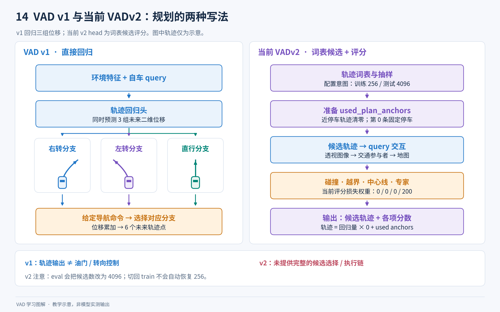

**图解 14｜理解两种规划写法，同时保留代码边界。** v1 直接产生三组位移；这里的 v2 从轨迹词表准备候选，让候选读取环境信息，再输出候选与各项分数。右图明确标出了当前配置的损失权重、停车候选处理及候选数状态变化，不能仅凭“多个评分头”就认为它们都受到非零直接监督。候选规划的总体思路可参照 [VADv2 论文第 3.2 节](https://arxiv.org/html/2402.13243v1)，而图中具体行为以本仓库文件为准；完整最终选择与控制链在这里未提供。

### 9.2 这两个文件里的实际流程

配置 [VADv2_config_voca4096.py](../VADv2/VADv2_config_voca4096.py) 使用 CARLA 数据语义：目标类别为 car、bicycle、motorcycle、pedestrian；地图类别包括 lane_divider、road_edge、crosswalk、centerline。与 v1 nuScenes 的类别、数据字段和地图标签并不相同。

[VADv2_head.py](../VADv2/VADv2_head.py) 中实际注册的类名为 `v116ADTRHead`，其主要思路是：

1. 加载 `carla_plan_vocabulary_4096.npy` 中的候选轨迹。
2. 配置训练时采样 256 条，测试时使用 4096 条候选。
3. 训练时尽量确保与专家真值轨迹最接近的候选进入集合，并固定一个停车候选。
4. 根据候选轨迹坐标构建位置编码，将每条候选变成规划 query。
5. 依次让 query 与透视图像特征、交通参与者特征、地图特征交互。
6. 融合目标点、自车状态和前视图像相关特征。
7. 输出候选轨迹对应的碰撞、越界、中心线一致性和专家行为相关分数，并辅助预测交通灯、停止标志相关状态。

这里需要注意有效代码与注释的区别：

- 虽然有轨迹回归分支，但最终 `outputs_ego_trajs` 被设置为 `回归输出 × 0 + used_plan_anchors`，因此返回的候选几何轨迹来自抽样并进行停车清零处理后的词表候选。
- “训练 256、测试 4096”是配置初值与预期使用方式。head 在 eval 时把 `self.plan_fut_mode` 原地改为测试候选数，同一实例切回 train 不会自动恢复 256，交替运行时需检查这个状态。
- 规划训练重点是候选评价；几个 v1 风格的连续轨迹约束在当前 `loss_planning()` 中直接产生零损失。
- 这份具体配置把碰撞、越界和中心线评分损失的权重也设为零，专家行为评分损失权重为 200；碰撞/越界标签还会参与专家行为标签的构建。不能把“定义了多个评分头”写成“这些头在该配置中都有非零监督”。
- “中心线分类”分支的实际目标是连续距离相关数值，配置使用 L1，不能只因变量名含 `cls` 就当作普通分类。
- 名为 kinodynamic filtering 的代码使用极大的阈值 `100000000000`，不能描述为实现了严格车辆动力学过滤。
- 融合式中指令 ID 特征乘以零；前视特征送入规划融合前有 `detach()`。这些具体设置不能凭参数名推断。
- 透视特征的直接融合项虽然乘以零，但它已通过前面的 cross-attention 影响后续 query，不能据此断言图像透视分支完全无效。

候选分数不是天然经过全候选归一化的概率分布。head 返回这些分数，但本工作区缺少完整 v2 detector/运行链，不能仅根据这两个文件确定最终车辆如何融合分数、选择轨迹并执行控制。

### 9.3 为什么这不是直接可运行的第二套工程

| 缺口 | 在本工作区的表现 |
| --- | --- |
| 基础配置相对路径 | `VADv2/` 下的 `_base_` 路径指向不存在的根级 `datasets/`、`_base_/` |
| detector 与 dataset | 配置中的 `v116ADTR`、`v3ADTRCustomCarlaDataset` 未在仓库提供 |
| 工具导入 | head 引用 `projects.mmdet3d_plugin.PIPP.*`，但没有该目录 |
| 专用 decoder、coder、assigner、loss | 多个 v0/CARLA 相关注册类型未提供 |
| 数据与权重 | 轨迹词表 `.npy`、CARLA pkl、相关 checkpoint 未附带 |
| 插件导入 | v1 插件没有自动导入这个根级 `VADv2_head.py` |
| 执行假设 | head 中有直接 `.cuda()`，并在一些候选操作中使用 batch 第 0 项 |

因此，学习 v2 可以从候选轨迹和评分逻辑开始；想运行它，需要完成数据、注册、模块依赖、权重和运行接口的集成，不能只把 v1 配置路径替换成 v2 文件。

## 10. 常见误解与修改代码时的注意点

### 10.1 经常出现的误解

| 误解 | 更准确的理解 |
| --- | --- |
| 端到端就是没有感知、预测模块 | VAD 明确保留这些模块，并联合学习 |
| BEV 是把六张图简单拼接到一起 | BEV 通过标定、参考点、可学习采样与时序融合构建 |
| 300 个 query 就会有 300 辆车 | query 是容量槽位，最终按分数和范围选择 |
| 一个 query 就是跨帧固定的车辆 ID | v1 主线没有提供完整显式目标跟踪 ID 链 |
| 6 种运动模式就是固定的左转、右转等标签 | 它们是学习出来的多模态候选，没有这种固定一一对应 |
| 自车 3 分支代表模型自己决定去哪里 | 分支由给定高层命令选择；离线命令来自真实未来 |
| `use_map=False` 不需要地图 | 不把真实地图当作常规感知输入，但训练监督仍需要地图 |
| 第二阶段只训练规划，其他网络全冻结 | 配置仍保留其他任务损失，继续联合训练 |
| 所有 loss 都非零且被使用 | 部分 loss 权重为 0，部分是兼容接口项，要看调用 |
| NMS-free 完全没有结果筛选 | 仍有 top-k、分数/范围等筛选，只是不做传统 NMS |
| loss 低就表示闭环驾驶可靠 | loss、开环指标和闭环驾驶衡量不同问题 |
| 规划 L2 越低就一定更安全 | 模仿误差和碰撞等指标提供不同信息 |
| 评估代码的碰撞计算就是部署安全约束 | 训练软约束、离线碰撞指标与在线安全机制是三种不同事物 |

### 10.2 修改参数通常需要同时改什么

| 想修改的内容 | 需要联动检查 |
| --- | --- |
| 图像缩放或裁剪 | 内参/投影矩阵、pipeline、预训练归一化、特征尺寸 |
| BEV 范围 | 数据过滤、地图 patch、encoder、coder、归一化与反归一化、评估范围 |
| BEV 格子数 | head、位置编码、transformer、历史 BEV 旋转中心 |
| 检测类别与顺序 | converter、dataset、head、损失类别判断、运动评估合并、可视化 |
| 地图类别与顺序 | GT 提取、head、map loss、规划边界/方向约束的类别索引 |
| 预测未来时间长度 | converter、属性字段打包、head 输出、mask、损失、评估中的 6 步/3 秒假设 |
| 相机数量和顺序 | dataset、标定、camera embeddings、图像变换和可视化 |
| 每 GPU batch | 时序缓存、变长 query padding、评估中 `bs=1` 断言等 |
| 新的数据集 | 坐标、标定、时间采样、轨迹定义、指令语义、地图语义和评估一起适配 |

特别是“把未来 6 步改成 12 步”，不能只改 head 中一个参数：数据字段切片和评估代码存在固定长度假设。修改类别顺序同样可能改变碰撞约束识别的对象，而不会产生明显的维度报错。

### 10.3 从这个仓库走向在线推理还缺什么

在线系统至少需要提供同步的相机图像、正确标定、实时自车运动状态、可靠的高层导航信息，并管理每条车辆流各自的历史缓存。还要把纯预测与读取 GT、计算离线指标的代码拆开。

模型输出轨迹后，还需要轨迹有效性检查、控制器、车辆接口、时间同步和运行状态处理。本文只用这段说明界定仓库的输出边界；不能把一个验证集测试脚本直接解释成完整驾驶软件。

## 11. 推荐的阅读和调试顺序

### 11.1 第一遍只跟一条主线

建议先选择 Tiny e2e 作为阅读配置，以免同时考虑两阶段权重切换：

1. 阅读 `projects/configs/VAD/VAD_tiny_e2e.py`，圈出 model、pipeline、data、optimizer 和 runner。
2. 阅读 `tools/train.py::main`，理解字典如何变成 dataset 和 model。
3. 阅读 `nuscenes_vad_dataset.py::prepare_train_data` 和 `union2one`，理解队列。
4. 阅读 `VAD.py::forward_train`，看历史帧和当前帧如何分开。
5. 阅读 `VAD_head.py::forward`，先按检测、地图、运动、规划四块画图。
6. 阅读 `VAD_transformer.py::get_bev_features`，再深入 encoder 和两种 attention。
7. 阅读 `VAD_head.py::loss` 及规划 loss，理解监督从哪里来。
8. 阅读 `VAD.py::forward_test`、`simple_test_pts` 和 dataset `evaluate`，理解输出与指标。

第一遍不必逐行弄懂 CUDA 扩展、所有地图几何处理或通用模型模板。先能够解释一个样本经历了什么，再逐步补齐细节。

### 11.2 推荐的观察点

| 位置 | 观察问题 |
| --- | --- |
| converter 输出单条 info | 图像路径、标定、未来轨迹、mask、command 是否自洽？ |
| `get_data_info()` | 一个样本的坐标与元信息如何进入 pipeline？ |
| `union2one()` | 图像是否变成队列？历史 CAN bus 位移是否相对化？ |
| `VAD.forward_train()` | 哪些图像属于历史、哪一帧有梯度？ |
| `get_bev_features()` | BEV 网格、shift、rotation 和相机特征形状是什么？ |
| `VADHead.forward()` | 每个输出对应哪种任务？最后两维是否是时间与 xy？ |
| `_get_target_single()` | 哪些 query 匹配真值、哪些是背景？ |
| `loss_planning()` | 哪个指令分支被监督？有效未来 mask 怎么作用？ |
| `simple_test_pts()` | 原始位移什么时候累加？什么时候只为打分读取 GT？ |
| `_format_bbox()` | 输出字典为何转换成按 sample token 索引的格式？ |

观察时优先打印 `shape`、数值范围、少量样本和 mask 数量，不要一次打印完整 BEV 张量。`[1,10000,256]` 已包含 256 万个数，全量输出反而妨碍理解。

### 11.3 检验自己是否理解了主线

试着不用看代码回答以下问题：为什么预测要有多个候选？为什么同一条地图线换一个点序不应该变成另一条路？历史 BEV 为什么必须对齐？为什么 stage-2 仍然需要感知损失？为什么有未来 GT 的测试脚本仍然可以评估一个不看未来的预测网络？

如果能够解释这些问题，再对照逐文件导航找到对应实现，就已经掌握了继续修改和实验所需的主要结构。

